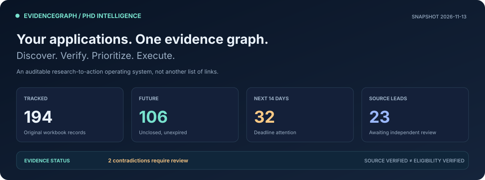

<div align="center">

<a href="PhD_Action_List.xlsx"></a>

### The application research cockpit

**Search the evidence. Resolve the proof debt. Execute the next dated task.**

[](../../actions/workflows/phd-intelligence.yml)
[](../../actions/workflows/intelligence-ci.yml)
[](../../actions/workflows/audit-workbook.yml)

[**View Excel tracker**](PhD_Action_List.xlsx) · [**Today's complete action plan**](docs/TODAY.md) · [**Private Action Center**](../../issues/1) · [**Run the automation**](../../actions/workflows/phd-intelligence.yml)

</div>

> [!IMPORTANT]
> **Observed snapshot: 2026-11-06 (Europe/Berlin).** Application deadlines, step dates and shared tasks are different data types. A task dated in the past is **completion-unconfirmed**, not automatically unfinished. Original verdicts are research assessments, not confirmed submission receipts. Primary sources determine final eligibility and deadlines.

<a href="docs/TODAY.md"></a>

## 01 · Execute — 2026-11-06

### Submission deadlines today — 2 actionable · 1 explicitly excluded

| When | Application / workstream | Action | Source |
|:--|:--|:--|:--|
| 2026-11-06 | University of Copenhagen, REVCAI PhD Project in Real-Time Visual  | Submit by 6 Nov 23:59 CET; tailor one-page motivation to real-time neural/point representations and GPU-aware perception. | [Official page](https://employment.ku.dk/phd?show=171663) |
| 2026-11-06 | TU/e Eindhoven, PhD Contrast Ultrasound Imaging of Nanobubbles fo | Apply by 6 Nov; show medical image analysis and quantitative inverse/signal modeling; verify C1 and degree equivalence. | [Official page](https://www.academictransfer.com/nl/jobs/363906/phd-in-contrast-ultrasound-imaging-of-nanobubbles-for-cancer-diagnostics/) |

### Cross-route work — 2 scheduled today

| Date | Cross-application task | Recorded status |
|:---|:---|:---|
| 2026-11-06 | Write the master research plan once (2 pages), then derive: the 2,000-word version (Osaka), the Field of Study and Research Plan forms (UTokyo, Saitama), and the criterion-by-criterion letters for the Jobbnorge posts. | To do |
| 2026-11-06 | Submit Copenhagen real-time visual-computing application by 23:59 CET; low-priority ultrasound position closes same day. | To do |

**Programme-specific steps due today** — 21 distinct records from the *Step timeline* worksheet, not inferred from the final submission date.

| When | Application / workstream | Action | Source |
|:--|:--|:--|:--|
| 2026-11-06 | University of Copenhagen REVCAI, PhD Real-Time Visual Computing a | Submit by 23:59 CET through University of Copenhagen recruitment site | [Official page](https://employment.ku.dk/phd?show=171663) |
| 2026-11-06 | Northeastern University London, PhD studentship: Algorithms/Hardw | By 2026-11-06 submit through the Workday Apply button quoting R143025 and state whether you are likely to need a visa (submit early because rolling sh | [Official page](https://www.jobs.ac.uk/job/DTI287/) |
| 2026-11-06 | Northeastern University London, PhD studentship: Algorithms/Hardw | Interviews planned during November 2026 | [Official page](https://www.jobs.ac.uk/job/DTI287/) |
| 2026-11-06 | NTNU Gjovik, Ph.D. Candidate in Reinforcement Learning for Projec | By 2026-11-06 contact University of Tehran to obtain transcripts and diplomas; gather diploma supplement and any HK-dir statement for foreign educatio | [Official page](https://www.jobbnorge.no/en/available-jobs/joblisting/pdf/310778) |
| 2026-11-06 | University of Oslo, PhD Research Fellow in Control Theory and Opt | By 2026-11-06 request an official explanation of the grading system of the University of Tehran, and get transcripts and diplomas; Vitnemalsportalen w | [Official page](https://www.jobbnorge.no/en/available-jobs/joblisting/pdf/310583) |
| 2026-11-06 | OsloMet PhD Fellow in Trustworthy Generative AI with Knowledge Ve | By 2026-11-06: contact two referees and get their contact details (page: 'preferably two references with contact information'; reference letters also  | [Official page](https://www.oslomet.no/en/work/job-openings/phd-fellow-in-trustworthy-generative-ai-with-knowledge-verification) |
| 2026-11-06 | Saitama University ESITI - MEXT Scholarship (University Recommend | Browse supervisors at https://park.saitama-u.ac.jp/~rese/courses.html and email 2-3 candidate supervisors for agreement to supervise, by 2026-11-06 (o | [Official page](https://park.saitama-u.ac.jp/~rese/admission.html) |
| 2026-11-06 | Memorial University - PhD Engineering and Applied Science, Fall 2 | Email 1-2 prospective supervisors in FEAS (page says research applicants should name up to two potential supervisors), by 2026-11-06 | [Official page](https://mun.ca/engineering/graduate/faq-for-prospective-research-students/) |
| 2026-11-06 | Memorial University - PhD Engineering and Applied Science, Fall 2 | Ask two referees (university-level, institutional email) by 2026-11-06; submit application 1-2 weeks early | [Official page](https://mun.ca/engineering/graduate/faq-for-prospective-research-students/) |
| 2026-11-06 | Oxford DPhil Engineering Science studentship: Data-driven Control | Request three referees (at least one academic) by 2026-11-06 | [Official page](https://www.jobs.ac.uk/job/DTJ272/) |
| 2026-11-06 | UEA / ARIES NERC DTP studentships (entry 1 Oct 2027) | By 2026-11-06 browse all 6 pages of https://aries-dtp.ac.uk/studentships/ and shortlist up to 3 projects (max 3 allowed per year) whose scope fits; pa | [Official page](https://www.aries-dtp.ac.uk/applications) |
| 2026-11-06 | University of Sydney Faculty of Engineering Research Scholarship  | By 2026-11-06 email engineering.hdr@sydney.edu.au asking in writing whether an Iranian citizen counts as 'a citizen from a country of the Middle East  | [Official page](https://www.sydney.edu.au/scholarships/b/faculty-of-engineering-research-scholarship-for-mena.html) |

<details>
<summary><b>Show every scheduled task today, the unconfirmed backlog, and exclusion reasons</b></summary>

The full execution queue preserves original worksheet row numbers and source IDs. No completion status is invented for the Step timeline.

[Open full, source-linked agenda](docs/TODAY.md) · [Inspect machine-readable plan](data/execution_plan.json) · [Open editable Task ledger](PhD_Action_List.xlsx)

**Not actionable today**

- **University of Newcastle (Australia) PhD scholarship: Hierarchical Imitation Learning for Long-Horizon Robotic ** — Not eligible; Newcastle PhD scholarships listing: 'Closing date: 06 November 2026'; time not printed

**Earlier dates with completion unconfirmed:** 97 tasks. 10 are cross-route tasks and 87 are programme timeline steps. They are **not automatically treated as outstanding** until the user confirms progress.

</details>

<a href="docs/TODAY.md"></a>

## 02 · Next decisions, not just a countdown

**Application deadlines during the next seven days (6)**

| When | Application / workstream | Action | Source |
|:--|:--|:--|:--|
| 2026-11-08 | Karlsruhe Institute of Technology (KIT MRT), PhD Efficient Long-C | Apply through official KIT job portal by 8 Nov. Emphasize transformer efficiency, long-context VLM inference and edge deployment. | [Official page](https://jobs.pse.kit.edu/en/jobs/170920/phd-position-efficient-long-context-large-models-for-vision-and-vision-language-action-systems-fmd) |
| 2026-11-08 | University of Copenhagen, CoAStaL PhD Cultural Reasoning with Lan | Submit by 8 Nov 23:59 CET. Connect RAG evidence verification and multilingual evaluation to cultural uncertainty, not generic LLM product work. | [Official page](https://employment.ku.dk/phd/?show=167227) |
| 2026-11-09 | UCL Gatsby Computational Neuroscience Unit, PhD in Machine Learni | Submit Gatsby 2027 portal application before 9 Nov 17:00 GMT; academic references by 10 Nov 23:59 GMT. Joint SWC track available as preference, not a  | [Official page](https://www.ucl.ac.uk/life-sciences/gatsby/study-and-work/gatsby-unit-phd-programme) |
| 2026-11-09 | UCL Sainsbury Wellcome Centre, fully funded PhD in Neural Circuit | Apply by 9 Nov 17:00 GMT if pursuing neural circuits; optional joint Gatsby–SWC via this OR Gatsby application, not independently. | [Official page](https://www.swc.science/content/apply-our-phd-programme) |
| 2026-11-10 | Swiss Government Excellence Scholarship (research/PhD), 2027-2028 | By 29 Oct 2026: email sgs@sbfi.admin.ch asking Iran's scholarship type and deadline and whether an Iranian resident in Turkey applies via Tehran or An | [Official page](https://www.sbfi.admin.ch/scholarships_eng) |
| 2026-11-13 | Southampton MSCA BlueOcean PhD Studentship, application 1 of 2: s | By 13 Nov 23:59 UK time: submit BlueOcean MSCA staff vacancy ref 3522426DA via jobs.soton.ac.uk. Also confirm and complete any separate PhD/project re | [Official page](https://jobs.soton.ac.uk/Vacancies.aspx?cat=1065&type=10) |

| Operating surface | Open | Decision supported |
|:--|:--|:--|
| **Execution board** | [Workbook](PhD_Action_List.xlsx) | Due tasks separated by source, date, eligibility and status |
| **Full Task ledger** | [Workbook](PhD_Action_List.xlsx) | Every application deadline and every programme/shared task with provenance |
| **Deadline and proof obligations** | [Decision frontier](data/portfolio_frontier.json) | Funding/eligibility contradictions and reusable-document dependencies |
| **Review queue** | [Research queue](data/discovered_candidates.json) | Search leads needing official source confirmation |
| **Live notifications** | [Private Action Center](../../issues/1) | Reminder history, conflicts and owner controls |
| **Academic trajectory** | [Research radar](data/research_radar.json) | Relevant papers for research positioning, not jobs |

## 03 · Evidence-backed search and auditability

<div align="center">
<a href="data/discovery_report.json"></a>
<a href="assets/readme/horizon.svg"></a>
</div>

| Search provider | Health | Observed | New unique |
|:--|:--|--:|--:|
| academicpositions | degraded | 0 | 0 |
| academictransfer | degraded | 0 | 0 |
| brave | disabled | 0 | 0 |
| inria | ok | 10 | 0 |

- **Contradictory source observations:** 2 monitor finding(s). A published programme deadline is not proof that an application portal is accepting submissions.
- **Research records:** 0 scholarly articles indexed separately, not counted as available PhD placements.
- **Discovery scope:** without configured Brave credentials, international web search is **disabled**. A healthy workflow cannot imply exhaustive worldwide coverage.

<details>
<summary><b>Research claims, exclusions and source integrity</b></summary>

The original *Dropped* and *Not added* tabs retain **6 dropped routes** and **200 researched-but-not-added routes**. They are an evidence base for explaining omissions, not proof that those programmes are permanently unsuitable.

The automated research queue contains 25 rows. Review both university vacancy records and eligibility/funding requirements before promoting a result to the main list.

[Source provenance](data/latest_run.json) · [Discovery report](data/discovery_report.json) · [Rejected and unadded decisions](PhD_Action_List.xlsx) · [Detailed methodology](docs/PRODUCT_RFC.md)

</details>

## 04 · All worksheets participate

The system is not limited to the deadline column. These sheets are retained in the repository workbook and have distinct operational roles.

| Worksheet | Role in the workflow |
|:--|:--|
| **Read me** | Original tracker documentation, eligibility and verdict rules |
| **Action list** | Master application records, verdicts, dates, funding, blockers and links |
| **Step timeline** | Dated programme-specific preparation and submission tasks |
| **What I need to do** | Cross-route checklist and user-maintained task statuses |
| **Dropped** | Rejected or inaccessible routes with source-specific reasons |
| **Not added** | Investigated leads deliberately excluded from the main list |
| **Research queue** | Discovered leads awaiting funding, eligibility and deadline review |
| **Mail signals** | Evidence extracted from personally reviewed recruitment correspondence |
| **Evidence ledger** | Source, observation date and proof of claims |
| **Source watch** | Website change and contradictory portal monitoring |
| **Decision frontier** | Application readiness uncertainty, proof debt and reusable assets |
| **Research radar** | Related publications only, never misclassified as vacancies |
| **Execution board** | Prioritized view of scheduled submissions and preparation tasks |
| **Task ledger** | Every dated programme task and original worksheet row, not just deadlines |

**Original workbook coverage:** 183 applications · 559 dated/programme-specific steps · 26 shared tasks · 6 dropped routes · 200 researched but unadded.

The generated **Execution board** and **Task ledger** can be filtered or edited locally. Derived sheets are regenerated; original source sheets and status cells are protected by integrity tests.

## 05 · GitHub as a private operating interface

<details open>
<summary><b>Owner-only interactive commands</b></summary>

Comment on [PhD Intelligence — Action Center](../../issues/1):

```text
/priority N263-02
/snooze N263-02 3d
/unsnooze N263-02
/mute N263-02
/unmute N263-02
/asset academic_cv ready
/asset research_statement in_progress
/asset transcripts unknown
```

Commands are validated against the repository owner, known source IDs and allowed state transitions. They are idempotent by comment ID, and are acknowledged only after committing changes. One-day and same-day application deadlines cannot be silenced.

**Resource readiness is never inferred from advertised requirements.** Update it explicitly, or retain the default `unknown`.

</details>

<details>
<summary><b>Advanced automation, integrations and scheduling</b></summary>

| Workflow | Trigger | Produces |
|:--|:--|:--|
| [Intelligence pipeline](.github/workflows/phd-intelligence.yml) | Twice daily and manually | Discovery, evidence reconciliation, workbook, README and notifications |
| [Workbook audit](.github/workflows/audit-workbook.yml) | Workbook-auditor changes or manually | Cross-tab inventory and date integrity |
| [Security and regression CI](.github/workflows/intelligence-ci.yml) | Code changes | Parser, deadline, snapshot and interaction tests |
| [Private issue commands](.github/workflows/issue-controls.yml) | Owner-created Issue comment | Priority, snooze, mute or explicit resource status |
| [Manual fallback](.github/workflows/refresh-tracker.yml) | On demand | Evidence-watch refresh |

Optional secrets are `BRAVE_SEARCH_API_KEY` (broad discovery), `GMAIL_CLIENT_ID`, `GMAIL_CLIENT_SECRET` and `GMAIL_REFRESH_TOKEN` (read-only email metadata), and `APPRISE_URLS` (external notifications). Without them, the corresponding capabilities are disabled rather than simulated.

</details>

<details>
<summary><b>System design, data lineage and state transitions</b></summary>

```mermaid
flowchart TD
    A["University vacancy sources"] --> C["Canonical identity & assertion ledger"]
    B["Optional broad research + Gmail metadata"] --> C
    X["arXiv research papers"] --> Y["Research context only"]
    C --> QPrimary evidence and eligibility verified?
    Q -->|"No"| R["Research queue + proof debt"]
    Q -->|"Yes, after review"| E["Excel Action list"]
    E --> T["Step timeline · dated tasks"]
    E --> D["Deadlines · applicant status"]
    G["What I need to do"] --> O["Full task planner"]
    T --> O
    D --> O
    H["Dropped / Not added"] --> O
    O --> U["Execution board + Task ledger"]
    O --> N["Action Center + deduplicated reminders"]
    Y --> N
    N --> V["Explicit owner commands"]
    V --> O
```

The engine cannot submit applications, invent funding eligibility, silently change a user decision, or execute arbitrary commands from third-party search content. Data merges are re-evaluated against current `main` to avoid binary workbook conflicts.

</details>

## 06 · Research contributions, not cosmetic features

1. **Temporal evidence and contradictions:** retain competing source assertions and review deadline changes.
2. **Multi-clock scheduling:** distinguish final application deadlines, preparation steps, shared deadlines, and overdue-completion uncertainty.
3. **Proof debt:** expose unknown eligibility/funding/document requirements without converting unknown to false.
4. **Reusable asset leverage:** reveal which confirmed document-readiness decisions may unblock multiple applications.
5. **Human-in-the-loop control:** per-application notifications with an auditable, owner-operated GitHub Issue.
6. **Coverage observability:** measure distinct discovery yield and explicit source outages rather than claiming world-scale recall.

[Product and engineering RFC](docs/PRODUCT_RFC.md) · [Technical architecture](docs/ARCHITECTURE.md) · [All tests](tests/) · [Operations checklist](docs/TODAY.md)

---

<sub><b>Generated:</b> 2026-11-06. Charts are static SVG snapshots regenerated by GitHub Actions; GitHub READMEs cannot run React or arbitrary JavaScript. This project combines known techniques in source monitoring and orchestration; uniqueness and commercial viability require independent evaluation, not branding claims.</sub>
