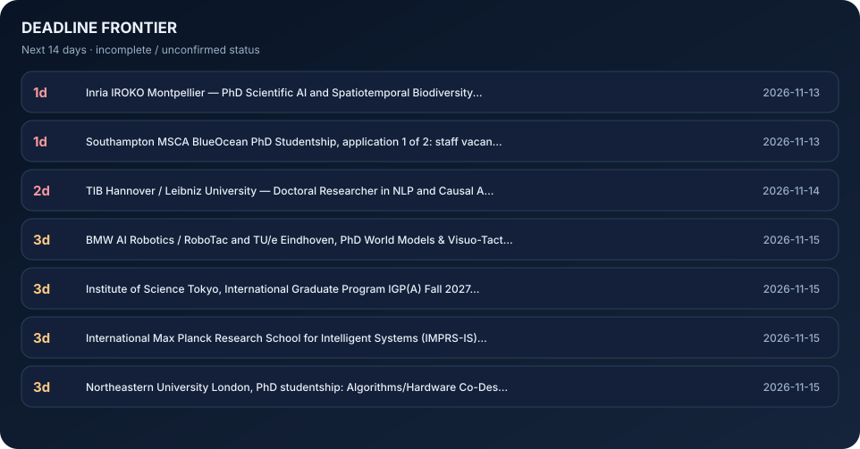
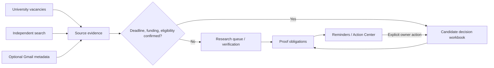
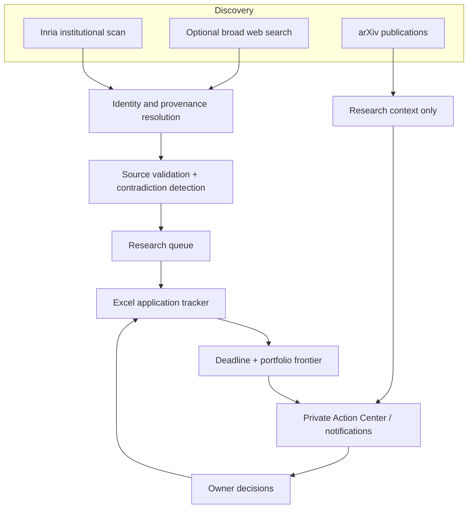

<div align="center">


**An evidence-first PhD application command center.**

[**Application workbook**](PhD_Action_List.xlsx) · [**Action Center**](../../issues/1) · [**Discovery inbox**](data/discovered_candidates.json) · [**Run the engine**](../../actions/workflows/phd-intelligence.yml)

</div>

> **Evidence policy** · Tracked applications are not necessarily open, funded or eligible. Automated discovery never changes user submission status. Dynamic visuals are generated from committed Excel and source artifacts.

<table>
<tr>
<td width="67%"><a href="assets/readme/deadlines.svg"></a></td>
<td width="33%"><a href="assets/readme/providers.svg"></a></td>
</tr>
</table>

<a href="assets/readme/horizon.svg"></a>

<sub>Last rendered: 2026-11-06 · GitHub READMEs do not execute embedded JavaScript; supported interaction is provided through native expandable sections, Mermaid, Issues and Actions.</sub>

## Command center

| Open | System action |
|:--|:--|
| **[Application tracker](PhD_Action_List.xlsx)** | Edit and confirm application decisions, deadlines, requirements and progress |
| **[Private Action Center](../../issues/1)** | See alerts, use owner-only snooze/priority commands and examine conflicts |
| **[Discover opportunities](../../actions/workflows/phd-intelligence.yml)** | Execute parallel source searches and reconcile the workbook |
| **[Research queue](data/discovered_candidates.json)** | Inspect URL identities, source histories and uncertain leads |
| **[Proof-obligation frontier](data/portfolio_frontier.json)** | Review reusable resources, readiness unknowns and source conflicts |
| **[CI and audits](../../actions/workflows/intelligence-ci.yml)** | Verify source adapter and workbook invariants |

## Next deadlines

| Days | Deadline | Application | Evidence |
|---:|:---:|---|---|
| **0d** | 2026-11-06 | TU/e Eindhoven, PhD Contrast Ultrasound Imaging of Nanobubbles for Cancer Diagnostics (MOMENTUM) | [Source](https://www.academictransfer.com/nl/jobs/363906/phd-in-contrast-ultrasound-imaging-of-nanobubbles-for-cancer-diagnostics/) |
| **0d** | 2026-11-06 | University of Copenhagen, REVCAI PhD Project in Real-Time Visual Computing and AI (Bernhard Kerbl) | [Source](https://employment.ku.dk/phd?show=171663) |
| **2d** | 2026-11-08 | Karlsruhe Institute of Technology (KIT MRT), PhD Efficient Long-Context Models for Vision and Vision-Lan | [Source](https://jobs.pse.kit.edu/en/jobs/170920/phd-position-efficient-long-context-large-models-for-vision-and-vision-language-action-systems-fmd) |
| **2d** | 2026-11-08 | University of Copenhagen, CoAStaL PhD Cultural Reasoning with Language Models (CuRe, Daniel Hershcovich) | [Source](https://employment.ku.dk/phd/?show=167227) |
| **3d** | 2026-11-09 | UCL Gatsby Computational Neuroscience Unit, PhD in Machine Learning and Theoretical Neuroscience, 2027 | [Source](https://www.ucl.ac.uk/life-sciences/gatsby/study-and-work/gatsby-unit-phd-programme) |
| **3d** | 2026-11-09 | UCL Sainsbury Wellcome Centre, fully funded PhD in Neural Circuits and Behaviour, 2027 intake | [Source](https://www.swc.science/content/apply-our-phd-programme) |
| **4d** | 2026-11-10 | Swiss Government Excellence Scholarship (research/PhD), 2027-2028 | [Source](https://www.sbfi.admin.ch/scholarships_eng) |
| **7d** | 2026-11-13 | Southampton MSCA BlueOcean PhD Studentship, application 1 of 2: staff vacancy ref 3522426DA (jobs.soton. | [Source](https://jobs.soton.ac.uk/Vacancies.aspx?cat=1065&type=10) |
| **9d** | 2026-11-15 | BMW AI Robotics / RoboTac and TU/e Eindhoven, PhD World Models & Visuo-Tactile Foundation Models (2 rese | [Source](https://www.robotac.eu/open-positions) |
| **9d** | 2026-11-15 | Institute of Science Tokyo, International Graduate Program IGP(A) Fall 2027 with MEXT recommendation | [Source](https://admissions.isct.ac.jp/en/013/graduate/programs/igp/igp-a) |
| **9d** | 2026-11-15 | International Max Planck Research School for Intelligent Systems (IMPRS-IS), 2027 doctoral recruitment | [Source](https://imprs.is.mpg.de/application) |
| **9d** | 2026-11-15 | Northeastern University London, PhD studentship: Algorithms/Hardware Co-Design for Bayesian and Ising Mo | [Source](https://www.jobs.ac.uk/job/DTI287/) |

<details>
<summary><b>Explore the interactive evidence pipeline</b></summary>



Research publications enter a distinct lane and cannot be inferred to be vacancies. Search result snippets never override dated institutional evidence.

</details>

<details>
<summary><b>Provider observability — find missed applications</b></summary>

| Collector | Observed | New distinct | State |
|---|---:|---:|---|
| academicpositions | 0 | 0 | degraded |
| academictransfer | 0 | 0 | degraded |
| brave | 0 | 0 | disabled |
| inria | 10 | 0 | ok |

Broad search is **disabled until** the optional `BRAVE_SEARCH_API_KEY` repository secret is configured. The Inria collector is an institutional signal, not comprehensive worldwide coverage. Each source must expose failure counts and unique yield; a completed Action does not mean comprehensive discovery.

[Discovery health report](data/discovery_report.json) · [Evidence source watch](data/latest_run.json)

</details>

<details>
<summary><b>Interactive owner commands — notifications without alert fatigue</b></summary>

Post a comment on the [private Action Center Issue](../../issues/1):

```text
/priority inria:2026-10570
/snooze inria:2026-10570 3d
/unsnooze inria:2026-10570
/mute inria:2026-10570
/unmute inria:2026-10570
/asset academic_cv ready
/asset research_statement in_progress
```

Only owner-authored commands on the marked Issue are interpreted. Unknown commands cannot execute code. Deadline-day and day-before reminders bypass snoozes. Outbound multi-channel notifications require optional `APPRISE_URLS` secrets.

</details>

<details>
<summary><b>Portfolio optimization — novel synthesis and limitations</b></summary>

**Application-as-constraint graph.** A candidate may have evidence assertions, deadlines and eligibility requirements. The applicant has reusable preparation assets whose readiness is either explicit or unknown. The system ranks *potential work reuse* across multiple applications and exposes proof debt, rather than inventing probabilities of acceptance.

The research frontier is an original engineering synthesis, **not** a proven globally first invention.

[Editable readiness](data/application_assets.json) · [Decision frontier](data/portfolio_frontier.json) · [Technical RFC](docs/PRODUCT_RFC.md)

</details>

## System architecture



<details>
<summary><b>Local development, tests and supported GitHub capabilities</b></summary>

```bash
python -m pip install -r requirements-intelligence.txt
python -m pytest -q tests
python scripts/refresh_tracker.py --online
python scripts/portfolio_frontier.py
python scripts/render_readme.py
```

UI uses generated SVG, standard Markdown tables, collapsible HTML `details`, Mermaid, and GitHub Issues. Arbitrary JavaScript, iframes, React components, server-rendered state and executable JS inside the README are not supported by GitHub's sanitizer. The SVG files are static snapshots, regenerated by Actions.

</details>

## Reliability contract

| Boundary | Guarantee |
|---|---|
| Application status | Human-owned; discovery cannot mark something submitted |
| Source identity | Stable IDs and canonical URL aliases |
| Contradictory deadlines | Never silently overwrite; retain observations and require review |
| Scheduling | Scheduled searches and transaction-safe publishing |
| Notifications | Deduplication, explicit controls and last-day override |
| Workbook | Existing sheets retained; outputs validated before publication |
| Privacy | Private repository; optional restricted Gmail metadata access |
| Evidence | Inspectable URLs and dated observation artifacts |

<sub>Engineering precedents: [changedetection.io](https://github.com/dgtlmoon/changedetection.io), [Apprise](https://github.com/caronc/apprise), [dlt](https://github.com/dlt-hub/dlt) and [Crawl4AI](https://github.com/unclecode/crawl4ai). <b>These are not claims of exclusive novelty, validated market size or billion-dollar valuation.</b></sub>
