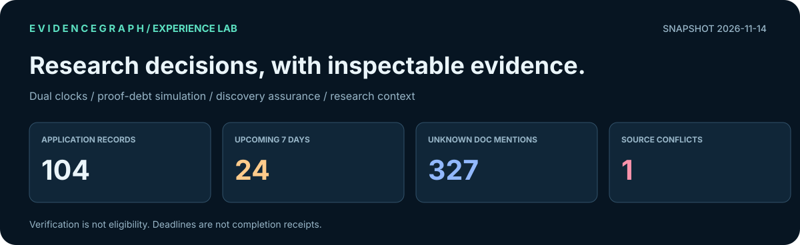
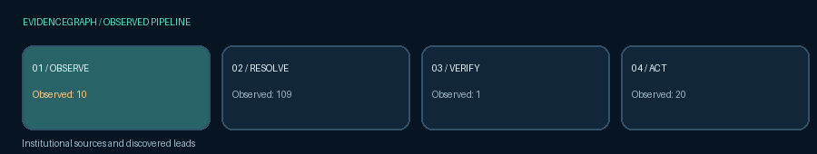
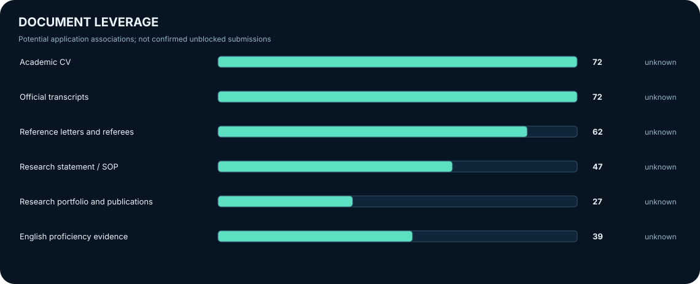

<div align="center">

<a href="dashboard/README.md"></a>

**EVIDENCEGRAPH · PhD APPLICATION INTELLIGENCE**

*Every deadline is dated. Every uncertainty is visible. Every decision links to evidence.*

[](../../actions/workflows/phd-intelligence.yml)
[](../../actions/workflows/intelligence-ci.yml)
[](../../actions/workflows/audit-workbook.yml)

[**APPLICATION WORKSPACE**](PhD_Action_List.xlsx) · [**DEADLINE OPERATIONS**](docs/TODAY.md) · [**INTERACTIVE OFFLINE LAB**](dashboard/README.md) · [**SOURCE PROVENANCE**](data/experience_lineage.jsonld) · [**OWNER COMMANDS**](../../issues/1)

</div>

## Research intelligence · observed 2026-11-07

<div align="center">

<a href="dashboard/README.md"></a>

**RESEARCH → EVIDENCE → DECISION → EXECUTION**

[Explore private interactive dashboard](dashboard/README.md) · [Inspect evidence JSON](data/experience_view.json) · [Explore W3C-style provenance graph](data/experience_lineage.jsonld)

</div>

<table>
<tr>
<td width="60%" valign="top"><a href="docs/TODAY.md"></a></td>
<td width="40%" valign="top"><a href="data/portfolio_frontier.json"></a></td>
</tr>
<tr>
<td><a href="data/research_radar.json"></a></td>
<td><a href="data/discovery_report.json"></a></td>
</tr>
</table>

### Investigate before acting

<table>
<tr>
<td width="33%"><b>01 · Find</b><p>Trace new leads and institutional sources.</p><a href="data/discovered_candidates.json">Discovery queue</a></td>
<td width="34%"><b>02 · Verify</b><p>Find contradictory evidence and unresolved eligibility.</p><a href="data/portfolio_frontier.json">Verification frontier</a></td>
<td width="33%"><b>03 · Execute</b><p>Review deadlines and explicitly mark task completion.</p><a href="docs/TODAY.md">Execution agenda</a></td>
</tr>
</table>

<details>
<summary><b>Explore the research and proof topology · expand visual laboratory</b></summary>

<a href="data/portfolio_frontier.json"></a>

<table><tr>
<td width="50%"></td>
<td width="50%"></td>
</tr></table>

The [offline observatory](dashboard/README.md) supports search, filters, separate submission and preparation clocks, evidence dossiers, document counterfactuals, deadline collisions, source-linked contradictions, verification queue and research-title term groups. GitHub's README renderer cannot execute browser JavaScript.

</details>

<details>
<summary><b>Evidence policy and provenance contract</b></summary>

- **Unknown is not false.** A document mentioned in a vacancy is not proof that it is missing.
- **A deadline is not a completed application.** Past steps retain unconfirmed status until owner action.
- **Source observation is not eligibility confirmation.** Evidence conflicts require manual review.
- **A paper is not an open position.** Research signals cannot be interpreted as funded recruitment.
- **No automatic submission.** Private owner controls preserve workbook decisions.

[Machine-readable view](data/experience_view.json) · [JSON-LD source lineage](data/experience_lineage.jsonld) · [System architecture](docs/ARCHITECTURE.md)

</details>

<sub>All figures are committed snapshots observed on 2026-11-07 (Europe/Berlin), not live counts. The application dashboard is a local, private HTML tool; it is not executed inside this README. No claims of worldwide novelty or verified admission probabilities.</sub>


### Navigate the command center

[**01 · Act now**](#01--execute--2026-11-07) · [**02 · Decide next**](#02--next-decisions-not-just-a-countdown) · [**03 · Verify sources**](#03--evidence-backed-search-and-auditability) · [**04 · Data model**](#04--all-worksheets-participate) · [**05 · Controls**](#05--github-as-a-private-operating-interface) · [**06 · Engineering**](#06--research-contributions-not-cosmetic-features)

| Priority | Immediate route | Outcome |
|:--|:--|:--|
| **Submit / verify** | [Review today's scheduled tasks](docs/TODAY.md) | Prevent missing a final deadline; confirm portal status and submission receipts |
| **Plan the workload** | [Today's execution plan](docs/TODAY.md) | Separate actual application deadlines from supporting steps and shared tasks |
| **Resolve uncertainty** | [Review proof obligations](data/portfolio_frontier.json) | Identify funding restrictions, portal contradictions, and missing evidence |
| **Explore opportunities** | [Discovery inbox](data/discovered_candidates.json) | Evaluate new leads before any promotion into the application list |
| **Operate reminders** | [Private Action Center](../../issues/1) | Mark tasks done, explicitly declare asset readiness, or snooze noncritical alerts |

#### Live operational signals (committed snapshot)

| Time critical | Source assurance | Applicant decisions | Research horizon |
|:--|:--|:--|:--|
| **5** deadline(s) in ≤3 days; **6** in the next 7 days | **1/4** active providers reporting healthy; **3** degraded/disabled | **0** dated steps today; **113** older steps with *completion unknown* | **34** indexed papers, research signals only |
| [Review every dated task](docs/TODAY.md) | [Source diagnostics](data/discovery_report.json) | [Confirm task status](../../issues/1) | [Research radar](data/research_radar.json) |

**Source consistency:** 6 observations across 6 configured monitors; 4 matched expected anchors and 2 require review. **Degraded sources:** academicpositions, academictransfer, brave.

<sub>Last official-page monitor: 2026-11-07 · last discovery: 2026-11-07 · last publication radar: 2026-11-07. These are observed snapshots, not live counters or a guarantee that any position is still accepting applicants.</sub>

> [!IMPORTANT]
> **Observed snapshot: 2026-11-07 (Europe/Berlin).** Application deadlines, step dates and shared tasks are different data types. A task dated in the past is **completion-unconfirmed**, not automatically unfinished. Original verdicts are research assessments, not confirmed submission receipts. Primary sources determine final eligibility and deadlines.

<a href="docs/TODAY.md"></a>

## Explore EvidenceGraph by outcome

<a href="docs/CAPABILITY_ATLAS.md"></a>

<table>
<tr>
<td width="33%" valign="top">

### Find a doctoral position

**Discover → verify → shortlist**

[Research queue](data/discovered_candidates.json) · [Search diagnostics](data/discovery_report.json)

Identify original institutional postings, duplicate URLs, uncertain eligibility, source failures and deadline contradictions. Never confuse a research paper with an open funded position.

</td>
<td width="33%" valign="top">

### Execute an application

**Plan → prepare → submit**

[Today's action plan](docs/TODAY.md) · [Portfolio frontier](data/portfolio_frontier.json)

Separate actual final deadlines from preparation steps, identify reusable materials and explicitly confirm statuses. An unknown task or asset state is not automatically classified as incomplete.

</td>
<td width="34%" valign="top">

### Operate the intelligence system

**Monitor → alert → improve**

[Private Action Center](../../issues/1) · [Live workflow](../../actions/workflows/phd-intelligence.yml)

Review source conflicts, snooze or prioritize individual applications and inspect coverage. Gmail and external alerts require configured credentials.

</td>
</tr>
</table>

| Want to... | Open this surface |
|:--|:--|
| Understand every available capability and its maturity | [Capability atlas — operational, conditional, degraded, proposed](docs/CAPABILITY_ATLAS.md) |
| Follow a complete real-world operating procedure | [Nine scenario playbooks](docs/PLAYBOOKS.md) |
| Report a changed deadline or closed portal | [Structured source correction](../../issues/new?template=01-source-correction.yml) |
| Submit a new PhD lead for human verification | [Structured opportunity intake](../../issues/new?template=02-opportunity-lead.yml) |
| Propose an experiment with metrics and rollback | [Automation experiment form](../../issues/new?template=03-automation-idea.yml) |
| Compare engineering intent with actual implementation | [System architecture](docs/ARCHITECTURE.md) · [Product RFC](docs/PRODUCT_RFC.md) |
| Inspect tests, provider failures and data lineage | [Regression CI](../../actions/workflows/intelligence-ci.yml) · [Evidence diagnostics](data/discovery_report.json) |

> [!NOTE]
> **Capability transparency:** Inria discovery and private GitHub reminders are operating. AcademicPositions is currently blocked (HTTP 403), AcademicTransfer has zero observed records, and Brave search requires an API key. External notifications, Gmail polling and Google Sheets synchronization are not claimed to be active without their respective configuration. The operational snapshot above is dated and must not be interpreted as real-time eligibility proof.

## 01 · Execute — 2026-11-07

### Submission deadlines today — 0 actionable · 0 explicitly excluded

| When | Application / workstream | Action | Source |
|:--|:--|:--|:--|
| — | None in the current snapshot | — | — |

### Cross-route work — 0 scheduled today

| Date | Cross-application task | Recorded status |
|:---|:---|:---|
| — | None scheduled today | — |

**Programme-specific steps due today** — 0 distinct records from the *Step timeline* worksheet, not inferred from the final submission date.

| When | Application / workstream | Action | Source |
|:--|:--|:--|:--|
| — | None in the current snapshot | — | — |

<details>
<summary><b>Show every scheduled task today, the unconfirmed backlog, and exclusion reasons</b></summary>

The full execution queue preserves original worksheet row numbers and source IDs. No completion status is invented for the Step timeline.

[Open full, source-linked agenda](docs/TODAY.md) · [Inspect machine-readable plan](data/execution_plan.json) · [Open editable Task ledger](PhD_Action_List.xlsx)

**Not actionable today**

No exclusions on this date.

**Earlier dates with completion unconfirmed:** 113 tasks. 12 are cross-route tasks and 101 are programme timeline steps. They are **not automatically treated as outstanding** until the user confirms progress.

</details>

<a href="docs/TODAY.md"></a>

## 02 · Next decisions, not just a countdown

**Application deadlines during the next seven days (6)**

| When | Application / workstream | Action | Source |
|:--|:--|:--|:--|
| 2026-11-08 | Karlsruhe Institute of Technology (KIT MRT), PhD Efficient Long-Context Models for Vision and Vision-Language-Action, 1252/20 | Apply through official KIT job portal by 8 Nov. Emphasize transformer efficiency, long-context VLM inference and edge deployment. | [Source page](https://jobs.pse.kit.edu/en/jobs/170920/phd-position-efficient-long-context-large-models-for-vision-and-vision-language-action-systems-fmd) · Action list · row 33 |
| 2026-11-08 | University of Copenhagen, CoAStaL PhD Cultural Reasoning with Language Models (CuRe, Daniel Hershcovich) | Submit by 8 Nov 23:59 CET. Connect RAG evidence verification and multilingual evaluation to cultural uncertainty, not generic LLM product work. | [Source page](https://employment.ku.dk/phd/?show=167227) · Action list · row 34 |
| 2026-11-09 | UCL Gatsby Computational Neuroscience Unit, PhD in Machine Learning and Theoretical Neuroscience, 2027 | Submit Gatsby 2027 portal application before 9 Nov 17:00 GMT; academic references by 10 Nov 23:59 GMT. Joint SWC track available as preference, not a separate application. | [Source page](https://www.ucl.ac.uk/life-sciences/gatsby/study-and-work/gatsby-unit-phd-programme) · Action list · row 35 |
| 2026-11-09 | UCL Sainsbury Wellcome Centre, fully funded PhD in Neural Circuits and Behaviour, 2027 intake | Apply by 9 Nov 17:00 GMT if pursuing neural circuits; optional joint Gatsby–SWC via this OR Gatsby application, not independently. | [Source page](https://www.swc.science/content/apply-our-phd-programme) · Action list · row 36 |
| 2026-11-10 | Swiss Government Excellence Scholarship (research/PhD), 2027-2028 | By 29 Oct 2026: email sgs@sbfi.admin.ch asking Iran's scholarship type and deadline and whether an Iranian resident in Turkey applies via Tehran or Ankara route | [Source page](https://www.sbfi.admin.ch/scholarships_eng) · Action list · row 37 |
| 2026-11-13 | Southampton MSCA BlueOcean PhD Studentship, application 1 of 2: staff vacancy ref 3522426DA (jobs.soton.ac.uk) | By 13 Nov 23:59 UK time: submit BlueOcean MSCA staff vacancy ref 3522426DA via jobs.soton.ac.uk. Also confirm and complete any separate PhD/project registration (linked form timing not verified). | [Source page](https://jobs.soton.ac.uk/Vacancies.aspx?cat=1065&type=10) · Action list · row 38 |

| Operating surface | Open | Decision supported |
|:--|:--|:--|
| **Execution board** | [Workbook](PhD_Action_List.xlsx) | Due tasks separated by source, date, eligibility and status |
| **Full Task ledger** | [Workbook](PhD_Action_List.xlsx) | Every application deadline and every programme/shared task with provenance |
| **Calendar reminders** | [Download ICS](calendar/phd_deadlines.ics) | Import all-day reminders for future tasks and deadlines; reimport when the workbook changes |
| **Deadline and proof obligations** | [Decision frontier](data/portfolio_frontier.json) | Funding/eligibility contradictions and reusable-document dependencies |
| **Review queue** | [Research queue](data/discovered_candidates.json) | Search leads needing official source confirmation |
| **Live notifications** | [Private Action Center](../../issues/1) | Reminder history, conflicts and owner controls |
| **Academic trajectory** | [Research radar](data/research_radar.json) | Relevant papers for research positioning, not jobs |

## 03 · Evidence-backed search and auditability

<div align="center">
<a href="data/discovery_report.json"></a>
<a href="assets/readme/horizon.svg"></a>
</div>

| Search provider | Health | Observed | New unique |
|:--|:--|--:|--:|
| academicpositions | degraded | 0 | 0 |
| academictransfer | degraded | 0 | 0 |
| brave | disabled | 0 | 0 |
| inria | ok | 12 | 0 |

- **Contradictory source observations:** 2 monitor finding(s). A published programme deadline is not proof that an application portal is accepting submissions.
- **Research records:** 34 scholarly articles indexed separately, not counted as available PhD placements.
- **Discovery scope:** without configured Brave credentials, international web search is **disabled**. A healthy workflow cannot imply exhaustive worldwide coverage.

<details>
<summary><b>Research claims, exclusions and source integrity</b></summary>

The original *Dropped* and *Not added* tabs retain **6 dropped routes** and **200 researched-but-not-added routes**. They are an evidence base for explaining omissions, not proof that those programmes are permanently unsuitable.

The automated research queue contains 27 rows. Review both university vacancy records and eligibility/funding requirements before promoting a result to the main list. Historical exclusions have **0 possible reappearance warning(s)**, which require manual review rather than automatic rejection.

[Source provenance](data/latest_run.json) · [Discovery report](data/discovery_report.json) · [Historical exclusion memory](data/exclusion_memory.json) · [Rejected and unadded decisions](PhD_Action_List.xlsx) · [Detailed methodology](docs/PRODUCT_RFC.md)

</details>

## 04 · All worksheets participate

The system is not limited to the deadline column. These sheets are retained in the repository workbook and have distinct operational roles.

| Worksheet | Role in the workflow |
|:--|:--|
| **Read me** | Original tracker documentation, eligibility and verdict rules |
| **Action list** | Master application records, verdicts, dates, funding, blockers and links |
| **Step timeline** | Dated programme-specific preparation and submission tasks |
| **What I need to do** | Cross-route checklist and user-maintained task statuses |
| **Dropped** | Rejected or inaccessible routes with source-specific reasons |
| **Not added** | Investigated leads deliberately excluded from the main list |
| **Research queue** | Discovered leads awaiting funding, eligibility and deadline review |
| **Mail signals** | Evidence extracted from personally reviewed recruitment correspondence |
| **Evidence ledger** | Source, observation date and proof of claims |
| **Source watch** | Website change and contradictory portal monitoring |
| **Decision frontier** | Application readiness uncertainty, proof debt and reusable assets |
| **Research radar** | Related publications only, never misclassified as vacancies |
| **Execution board** | Prioritized view of scheduled submissions and preparation tasks |
| **Task ledger** | Every dated programme task and original worksheet row, not just deadlines |
| **Exclusion memory** | Historical dropped and not-added evidence; reappearing leads are flagged, never silently rejected |

**Original workbook coverage:** 183 applications · 559 dated/programme-specific steps · 26 shared tasks · 6 dropped routes · 200 researched but unadded.

The generated **Execution board** and **Task ledger** can be filtered or edited locally. Derived sheets are regenerated; original source sheets and status cells are protected by integrity tests.

## 05 · GitHub as a private operating interface

<details open>
<summary><b>Owner-only interactive commands</b></summary>

Comment on [PhD Intelligence — Action Center](../../issues/1):

```text
/priority N263-02
/snooze N263-02 3d
/unsnooze N263-02
/mute N263-02
/unmute N263-02
/asset academic_cv ready
/asset research_statement in_progress
/asset transcripts unknown
/done tsk-<copy-task-id-from-daily-agenda>
/reopen tsk-<copy-task-id-from-daily-agenda>
```

Commands are validated against the repository owner, known source IDs, allowed states and stable task IDs. Use a real `tsk-...` identifier printed beside each programme/shared task in the agenda; `/done` and `/reopen` update a private completion overlay, regenerate the workbook/README and never alter original submission states. Comments are idempotent by ID and acknowledged after successful commits. Same-day and next-day deadlines cannot be muted.

**Resource readiness is never inferred from advertised requirements.** Update it explicitly, or retain the default `unknown`.

</details>

<details>
<summary><b>Advanced automation, integrations and scheduling</b></summary>

| Workflow | Trigger | Produces |
|:--|:--|:--|
| [Intelligence pipeline](.github/workflows/phd-intelligence.yml) | Twice daily and manually | Discovery, evidence reconciliation, workbook, README and notifications |
| [Workbook audit](.github/workflows/audit-workbook.yml) | Workbook-auditor changes or manually | Cross-tab inventory and date integrity |
| [Security and regression CI](.github/workflows/intelligence-ci.yml) | Code changes | Parser, deadline, snapshot and interaction tests |
| [Private issue commands](.github/workflows/issue-controls.yml) | Owner-created Issue comment | Priority, snooze, mute or explicit resource status |
| [Manual fallback](.github/workflows/refresh-tracker.yml) | On demand | Evidence-watch refresh |

Optional secrets are `BRAVE_SEARCH_API_KEY` (broad discovery), `GMAIL_CLIENT_ID`, `GMAIL_CLIENT_SECRET` and `GMAIL_REFRESH_TOKEN` (read-only email metadata), and `APPRISE_URLS` (external notifications). Without them, the corresponding capabilities are disabled rather than simulated.

</details>

<details>
<summary><b>System design, data lineage and state transitions</b></summary>

```mermaid
flowchart TD
    A["University vacancy sources"] --> C["Canonical identity & assertion ledger"]
    B["Optional broad research + Gmail metadata"] --> C
    X["arXiv research papers"] --> Y["Research context only"]
    C --> QPrimary evidence and eligibility verified?
    Q -->|"No"| R["Research queue + proof debt"]
    Q -->|"Yes, after review"| E["Excel Action list"]
    E --> T["Step timeline · dated tasks"]
    E --> D["Deadlines · applicant status"]
    G["What I need to do"] --> O["Full task planner"]
    T --> O
    D --> O
    H["Dropped / Not added"] --> O
    O --> U["Execution board + Task ledger"]
    O --> N["Action Center + deduplicated reminders"]
    Y --> N
    N --> V["Explicit owner commands"]
    V --> O
```

The engine cannot submit applications, invent funding eligibility, silently change a user decision, or execute arbitrary commands from third-party search content. Data merges are re-evaluated against current `main` to avoid binary workbook conflicts.

</details>

## From a GitHub repository to an operating system

<details>
<summary><b>Use case A — an application closes today</b></summary>

**Deadline → application portal → explicit verification → preparation steps → receipt.** Start with [today's execution plan](docs/TODAY.md), inspect the primary source, verify the time zone, and submit directly to the university. The system records a deadline and tasks; it **does not** confirm that the application was submitted. Only a portal receipt or your explicit decision can establish that state.

</details>

<details>
<summary><b>Use case B — a recruiting lab publishes a contradictory deadline</b></summary>

**Evidence comparison → proof debt → human resolution.** The [source monitor](data/latest_run.json) checks observed institutional assertions. A closed application portal does not automatically overwrite an advertised deadline; the contradiction appears in the [decision frontier](data/portfolio_frontier.json) and the [Action Center](../../issues/1).

</details>

<details>
<summary><b>Use case C — a single document is needed for multiple applications</b></summary>

**Reusable document → explicit readiness → deadline dependency.** Review [document leverage](data/portfolio_frontier.json) and set your real state in the [Action Center](../../issues/1), for example `/asset research_statement in_progress`. Mentions of a CV, statement, or transcript in vacancy text are **not** proof that you lack the document.

</details>

<details>
<summary><b>Use case D — find a lab before an official vacancy exists</b></summary>

The [research radar](data/research_radar.json) monitors topical publications in robotics, vision, medical AI and related areas. Research papers provide context for prospective supervisors and SOP positioning; they are **not** interpreted as funded openings. The [discovery pipeline](.github/workflows/phd-intelligence.yml) independently monitors actual vacancies, with source limitations disclosed.

</details>

### Delivery truth table

| Capability | Current implementation | Trust boundary |
|:--|:--|:--|
| Scheduled search | Twice-daily matrix of institutional/marketplace connectors | A source may fail, block crawlers, or return no results |
| Deadline-driven execution | Separate final deadlines, programme steps and shared tasks | Past completion is unknown unless explicitly recorded |
| Opportunity reconciliation | Canonical URL deduplication, source history and review queue | Search snippets never prove funding or eligibility |
| Repository notifications | Owner-assigned Issue and threshold-based reminders | Notification delivery outside GitHub needs an opt-in endpoint |
| Interactive commands | Owner-scoped task, asset and alert controls | Neither a GitHub comment nor a scraped page executes arbitrary shell commands |
| Email intelligence | Existing reviewed signals; optional OAuth metadata intake | Gmail automation requires separately configured read-only credentials |
| Research radar | arXiv publications displayed apart from vacancy records | Papers do not establish a recruiting PhD position |
| Workbook integrity | Cross-sheet audit, regression CI and conflict-safe publication | The original cloud Google Sheet is not live-synced |
| Commercial roadmap | [EvidenceGraph product RFC](docs/PRODUCT_RFC.md) | Novelty, predictive quality, and revenue have **not** been established experimentally |

## 06 · Research contributions, not cosmetic features

1. **Temporal evidence and contradictions:** retain competing source assertions and review deadline changes.
2. **Multi-clock scheduling:** distinguish final application deadlines, preparation steps, shared deadlines, and overdue-completion uncertainty.
3. **Proof debt:** expose unknown eligibility/funding/document requirements without converting unknown to false.
4. **Reusable asset leverage:** reveal which confirmed document-readiness decisions may unblock multiple applications.
5. **Human-in-the-loop control:** per-application notifications with an auditable, owner-operated GitHub Issue.
6. **Coverage observability:** measure distinct discovery yield and explicit source outages rather than claiming world-scale recall.

[Product and engineering RFC](docs/PRODUCT_RFC.md) · [Technical architecture](docs/ARCHITECTURE.md) · [All tests](tests/) · [Operations checklist](docs/TODAY.md)

---

<sub><b>Generated:</b> 2026-11-07. Charts are static SVG snapshots regenerated by GitHub Actions; GitHub READMEs cannot run React or arbitrary JavaScript. This project combines known techniques in source monitoring and orchestration; uniqueness and commercial viability require independent evaluation, not branding claims.</sub>
