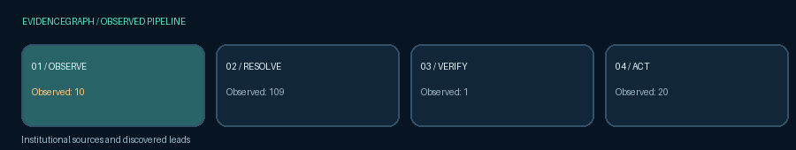
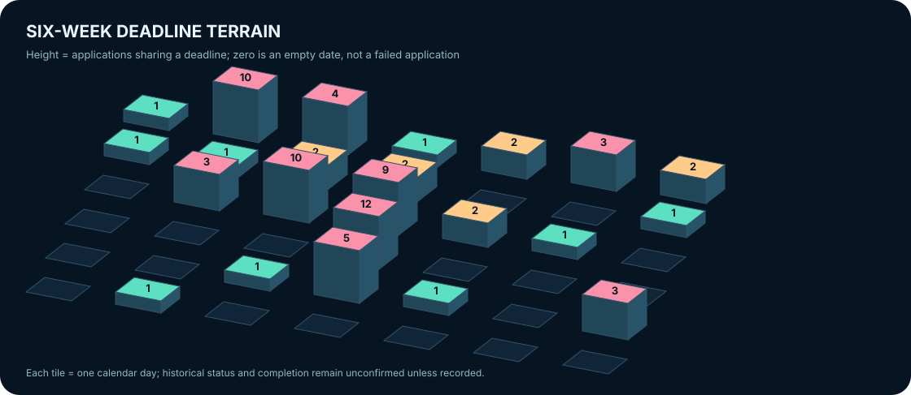
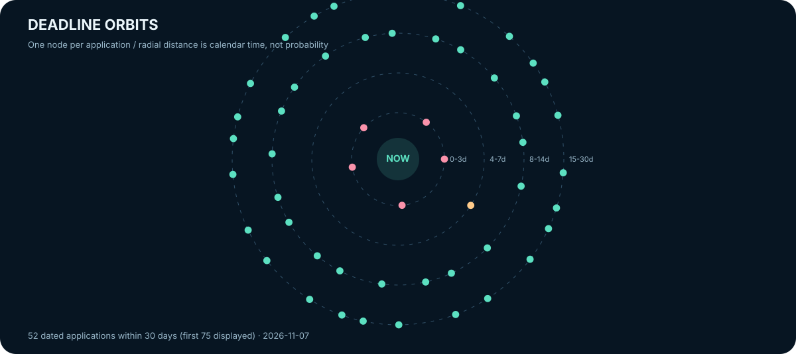
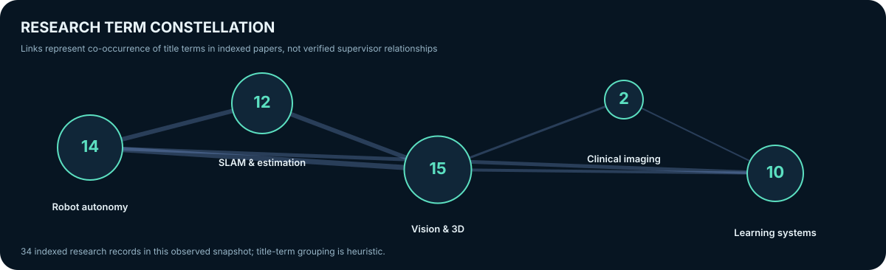
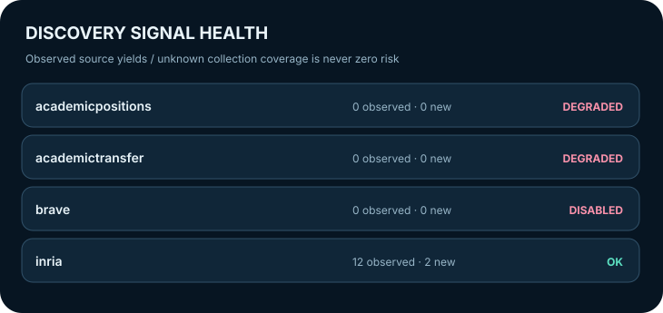
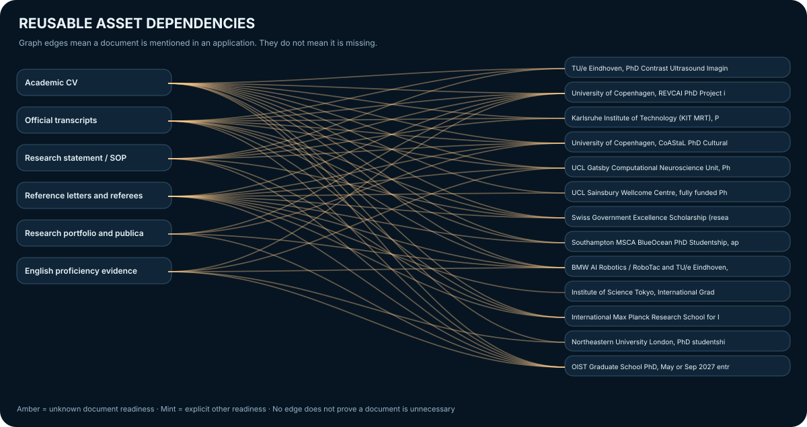
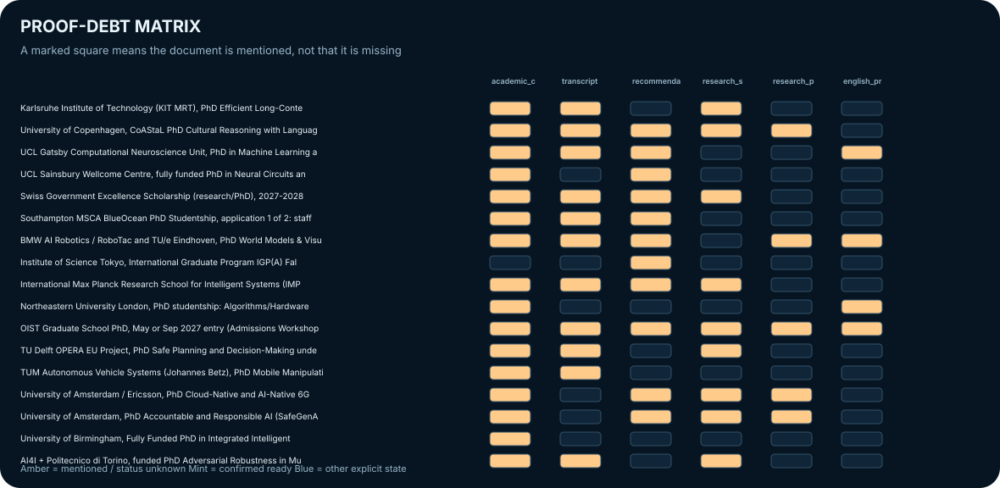
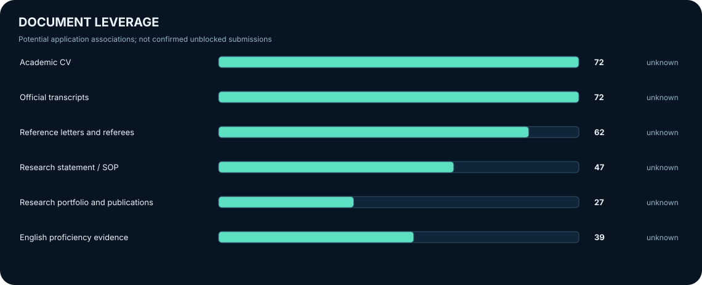

## Research intelligence · observed 2026-11-07

**RESEARCH → EVIDENCE → DECISION → EXECUTION**

[Explore private interactive dashboard](../dashboard/README.md) · [Inspect evidence JSON](../data/experience_view.json) · [Explore W3C-style provenance graph](../data/experience_lineage.jsonld)

<table>
<tr>
<td width="60%" valign="top"></td>
<td width="40%" valign="top"></td>
</tr>
<tr>
<td></td>
<td></td>
</tr>
</table>

### Investigate before acting

<table>
<tr>
<td width="33%"><b>01 · Find</b>
Trace new leads and institutional sources.
<a href="../data/discovered_candidates.json">Discovery queue</a></td>
<td width="34%"><b>02 · Verify</b>
Find contradictory evidence and unresolved eligibility.
<a href="../data/portfolio_frontier.json">Verification frontier</a></td>
<td width="33%"><b>03 · Execute</b>
Review deadlines and explicitly mark task completion.
<a href="TODAY.md">Execution agenda</a></td>
</tr>
</table>

<b>Explore the research and proof topology · expand visual laboratory</b>

<table><tr>
<td width="50%"></td>
<td width="50%"></td>
</tr></table>

The [offline observatory](../dashboard/README.md) supports search, filters, separate submission and preparation clocks, evidence dossiers, document counterfactuals, deadline collisions, source-linked contradictions, verification queue and research-title term groups. GitHub's README renderer cannot execute browser JavaScript.

<b>Evidence policy and provenance contract</b>

- **Unknown is not false.** A document mentioned in a vacancy is not proof that it is missing.
- **A deadline is not a completed application.** Past steps retain unconfirmed status until owner action.
- **Source observation is not eligibility confirmation.** Evidence conflicts require manual review.
- **A paper is not an open position.** Research signals cannot be interpreted as funded recruitment.
- **No automatic submission.** Private owner controls preserve workbook decisions.

[Machine-readable view](../data/experience_view.json) · [JSON-LD source lineage](../data/experience_lineage.jsonld) · [System architecture](docs/ARCHITECTURE.md)

All figures are committed snapshots observed on 2026-11-07 (Europe/Berlin), not live counts. The application dashboard is a local, private HTML tool; it is not executed inside this README. No claims of worldwide novelty or verified admission probabilities.
