# Generated evidence report

[Overview](../README.md) · [Open workspace](https://armanasq.github.io/phd_tracker/)

**Snapshot:** 2026-11-10. This report is generated from committed evidence, not live admissions information.

<div align="center">

# PhD Tracker · EvidenceGraph

**AI-powered research discovery, source verification, application planning, and reproducible execution.**

<a href="https://github.com/Armanasq/phd_tracker/actions/workflows/experience-lab.yml"></a>

[**DISCOVER**](#research--application-pipeline) · [**VERIFY**](#opportunity-funnel--actual-deadline-horizons) · [**ANALYZE**](#research-focus-quadrant) · [**PLAN**](#deadline-gantt--application-milestones) · [**SIMULATE**](#interactive-exploration--simulation-lab) · [**EXECUTE**](#github-native-workflow-console)

<sub>Observed 2026-11-10 · Metrics are derived from source snapshots, not example values or inferred admissions outcomes.</sub>

</div>

<table><tr>
<td align="center" width="16%"><b>OPPORTUNITIES</b><h2>107</h2><sub>dated frontier</sub></td>
<td align="center" width="16%"><b>UPCOMING</b><h2>19</h2><sub>next seven days</sub></td>
<td align="center" width="16%"><b>PROOF STATES</b><h2>335</h2><sub>unknown document mentions</sub></td>
<td align="center" width="16%"><b>RESEARCH</b><h2>68</h2><sub>indexed papers</sub></td>
<td align="center" width="16%"><b>SOURCES</b><h2>1/4</h2><sub>healthy providers</sub></td>
<td align="center" width="16%"><b>CONTRADICTIONS</b><h2>1</h2><sub>source review flags</sub></td>
</tr></table>

[**Overview**](#research--application-pipeline) · [**Pipeline**](#research--application-pipeline) · [**Opportunity Map**](#global-opportunities--interactive-github-map) · [**Timeline**](#deadline-gantt--application-milestones) · [**Knowledge Graph**](#research--application-knowledge-graph) · [**Applications**](#upcoming-application-records) · [**Simulation Lab**](#interactive-exploration--simulation-lab) · [**Workflows**](#github-native-workflow-console)

---

## Research & application pipeline

The diagram below is **native Mermaid**. GitHub renders it as a diagram, not as an SVG screenshot.

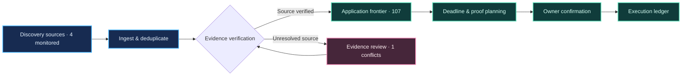

## Opportunity funnel · actual deadline horizons

This Sankey partitions the 107 dated portfolio records by their remaining calendar horizon; it does not imply historical conversion between recruitment stages.

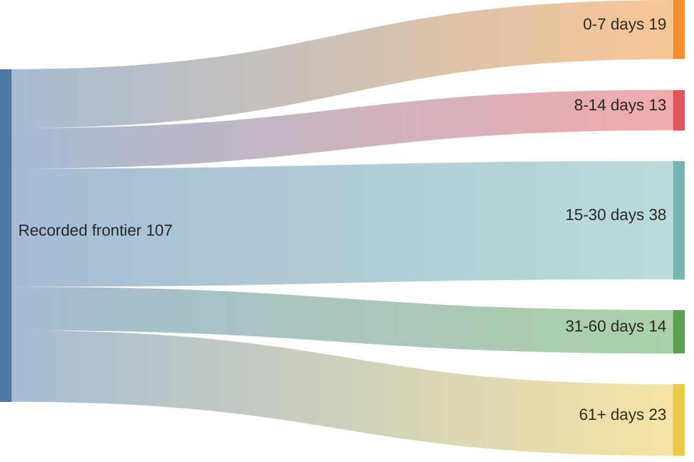

<details>
<summary><b>Show the source-provider verification mix</b></summary>

| Provider | Recorded health | Observed leads | New unique leads |
|:--|:--|--:|--:|
| academicpositions | degraded | 0 | 0 |
| academictransfer | degraded | 0 | 0 |
| brave | disabled | 0 | 0 |
| inria | ok | 10 | 0 |

Provider health is not an estimate of search completeness. 3 channels are degraded or disabled.

</details>

## Deadline Gantt · application milestones

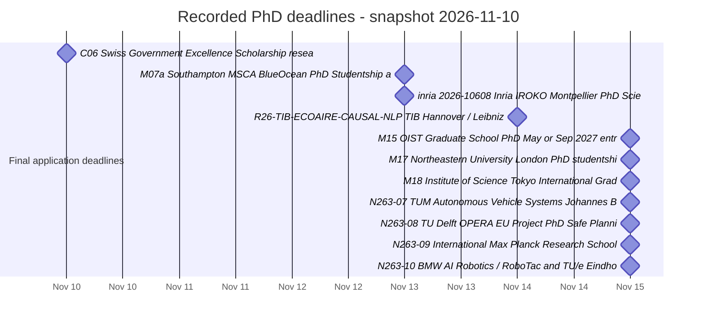

<details>
<summary><b>Expand the quantitative deadline horizon chart</b></summary>

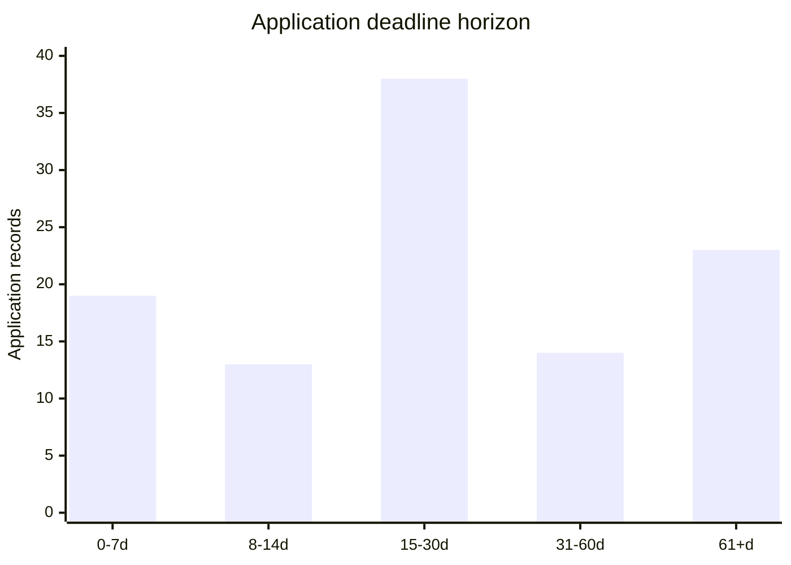

</details>

## Global opportunities · interactive GitHub map

```geojson
{"type":"FeatureCollection","features":[{"type":"Feature","properties":{"title":"Germany: 3 application records","description":"Country-level aggregate inferred from an unambiguous institution name; pin placed at representative capital city, not at a university","count":3,"sample_source_ids":"N263-09, N263-07, N264-10","marker-color":"#9f61e8","marker-size":"medium"},"geometry":{"type":"Point","coordinates":[13.405,52.52]}},{"type":"Feature","properties":{"title":"United Kingdom: 16 application records","description":"Country-level aggregate inferred from an unambiguous institution name; pin placed at representative capital city, not at a university","count":16,"sample_source_ids":"M17, N263-11, M25","marker-color":"#19b5b6","marker-size":"large"},"geometry":{"type":"Point","coordinates":[-0.1276,51.5072]}},{"type":"Feature","properties":{"title":"Netherlands: 8 application records","description":"Country-level aggregate inferred from an unambiguous institution name; pin placed at representative capital city, not at a university","count":8,"sample_source_ids":"N263-10, N263-08, N264-03","marker-color":"#19b5b6","marker-size":"large"},"geometry":{"type":"Point","coordinates":[4.9041,52.3676]}},{"type":"Feature","properties":{"title":"Switzerland: 10 application records","description":"Country-level aggregate inferred from an unambiguous institution name; pin placed at representative capital city, not at a university","count":10,"sample_source_ids":"C06, M23, M24","marker-color":"#19b5b6","marker-size":"large"},"geometry":{"type":"Point","coordinates":[7.4474,46.948]}},{"type":"Feature","properties":{"title":"Norway: 6 application records","description":"Country-level aggregate inferred from an unambiguous institution name; pin placed at representative capital city, not at a university","count":6,"sample_source_ids":"M19, M20, M21","marker-color":"#9f61e8","marker-size":"medium"},"geometry":{"type":"Point","coordinates":[10.7522,59.9139]}},{"type":"Feature","properties":{"title":"Sweden: 3 application records","description":"Country-level aggregate inferred from an unambiguous institution name; pin placed at representative capital city, not at a university","count":3,"sample_source_ids":"N264-07, N264-09, R26-KTH-AGENTIC-EMBODIED","marker-color":"#9f61e8","marker-size":"medium"},"geometry":{"type":"Point","coordinates":[18.0632,59.3346]}},{"type":"Feature","properties":{"title":"Denmark: 1 application records","description":"Country-level aggregate inferred from an unambiguous institution name; pin placed at representative capital city, not at a university","count":1,"sample_source_ids":"N264-08","marker-color":"#4384ff","marker-size":"medium"},"geometry":{"type":"Point","coordinates":[12.5683,55.6761]}},{"type":"Feature","properties":{"title":"Japan: 6 application records","description":"Country-level aggregate inferred from an unambiguous institution name; pin placed at representative capital city, not at a university","count":6,"sample_source_ids":"M18, M15, C15-NAGOYA","marker-color":"#9f61e8","marker-size":"medium"},"geometry":{"type":"Point","coordinates":[139.6917,35.6895]}},{"type":"Feature","properties":{"title":"France: 3 application records","description":"Country-level aggregate inferred from an unambiguous institution name; pin placed at representative capital city, not at a university","count":3,"sample_source_ids":"inria:2026-10608, inria:2026-10570, inria:2026-10454","marker-color":"#9f61e8","marker-size":"medium"},"geometry":{"type":"Point","coordinates":[2.3522,48.8566]}},{"type":"Feature","properties":{"title":"Italy: 3 application records","description":"Country-level aggregate inferred from an unambiguous institution name; pin placed at representative capital city, not at a university","count":3,"sample_source_ids":"N264-05, N264-04, R26-AI4I-TRUSTWORTHY-GENERALIST","marker-color":"#9f61e8","marker-size":"medium"},"geometry":{"type":"Point","coordinates":[12.4964,41.9028]}},{"type":"Feature","properties":{"title":"Cyprus: 1 application records","description":"Country-level aggregate inferred from an unambiguous institution name; pin placed at representative capital city, not at a university","count":1,"sample_source_ids":"R26-UCY-SKEYES","marker-color":"#4384ff","marker-size":"medium"},"geometry":{"type":"Point","coordinates":[33.3823,35.1856]}},{"type":"Feature","properties":{"title":"Luxembourg: 1 application records","description":"Country-level aggregate inferred from an unambiguous institution name; pin placed at representative capital city, not at a university","count":1,"sample_source_ids":"M26","marker-color":"#4384ff","marker-size":"medium"},"geometry":{"type":"Point","coordinates":[6.1319,49.6116]}},{"type":"Feature","properties":{"title":"United States: 1 application records","description":"Country-level aggregate inferred from an unambiguous institution name; pin placed at representative capital city, not at a university","count":1,"sample_source_ids":"R26-GWU-EPIC","marker-color":"#4384ff","marker-size":"medium"},"geometry":{"type":"Point","coordinates":[-77.0369,38.9072]}},{"type":"Feature","properties":{"title":"Canada: 8 application records","description":"Country-level aggregate inferred from an unambiguous institution name; pin placed at representative capital city, not at a university","count":8,"sample_source_ids":"M33, M31, M34","marker-color":"#19b5b6","marker-size":"large"},"geometry":{"type":"Point","coordinates":[-75.6972,45.4215]}},{"type":"Feature","properties":{"title":"Australia: 1 application records","description":"Country-level aggregate inferred from an unambiguous institution name; pin placed at representative capital city, not at a university","count":1,"sample_source_ids":"M43a","marker-color":"#4384ff","marker-size":"medium"},"geometry":{"type":"Point","coordinates":[149.13,-35.2809]}},{"type":"Feature","properties":{"title":"Austria: 1 application records","description":"Country-level aggregate inferred from an unambiguous institution name; pin placed at representative capital city, not at a university","count":1,"sample_source_ids":"R26-VIENNA-EXOSPHERE","marker-color":"#4384ff","marker-size":"medium"},"geometry":{"type":"Point","coordinates":[16.3738,48.2082]}}]}
```

**72/107** applications have unambiguous institution-name country matches, aggregated into **16** country markers. The markers are at representative capital locations, **not university campus coordinates**. The remaining 35 records are deliberately excluded from the geographic visualization rather than assigned guessed locations.

<details>
<summary><b>Explore country counts and mapped source IDs</b></summary>

| Country aggregation | Example application IDs |
|:--|:--|
| United Kingdom: 16 application records | M17, N263-11, M25 |
| Switzerland: 10 application records | C06, M23, M24 |
| Netherlands: 8 application records | N263-10, N263-08, N264-03 |
| Canada: 8 application records | M33, M31, M34 |
| Norway: 6 application records | M19, M20, M21 |
| Japan: 6 application records | M18, M15, C15-NAGOYA |
| Germany: 3 application records | N263-09, N263-07, N264-10 |
| Sweden: 3 application records | N264-07, N264-09, R26-KTH-AGENTIC-EMBODIED |
| France: 3 application records | inria:2026-10608, inria:2026-10570, inria:2026-10454 |
| Italy: 3 application records | N264-05, N264-04, R26-AI4I-TRUSTWORTHY-GENERALIST |
| Denmark: 1 application records | N264-08 |
| Cyprus: 1 application records | R26-UCY-SKEYES |
| Luxembourg: 1 application records | M26 |
| United States: 1 application records | R26-GWU-EPIC |
| Australia: 1 application records | M43a |

[Complete GeoJSON file](../data/readme_opportunities.geojson) · [Source portfolio](../data/portfolio_frontier.json)

</details>

## Research & application knowledge graph

This native Mermaid ER diagram represents relationships from the actual application, source-monitor, resource, and research schemas.

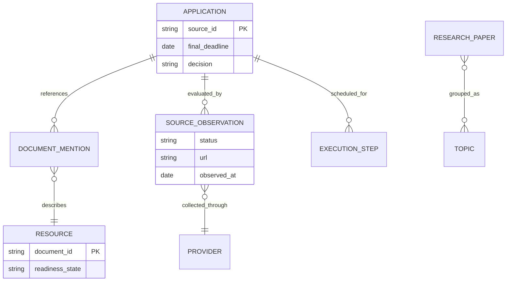

<details>
<summary><b>Agent/tool orchestration · expand Mermaid sequence diagram</b></summary>

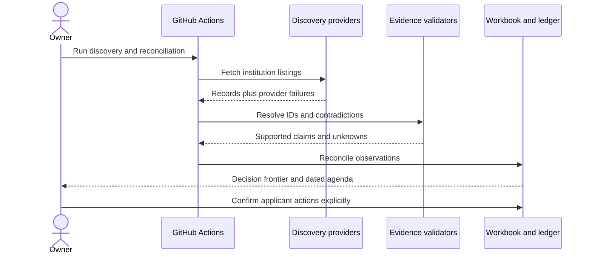

</details>

<details>
<summary><b>Application state machine · expand Mermaid states</b></summary>

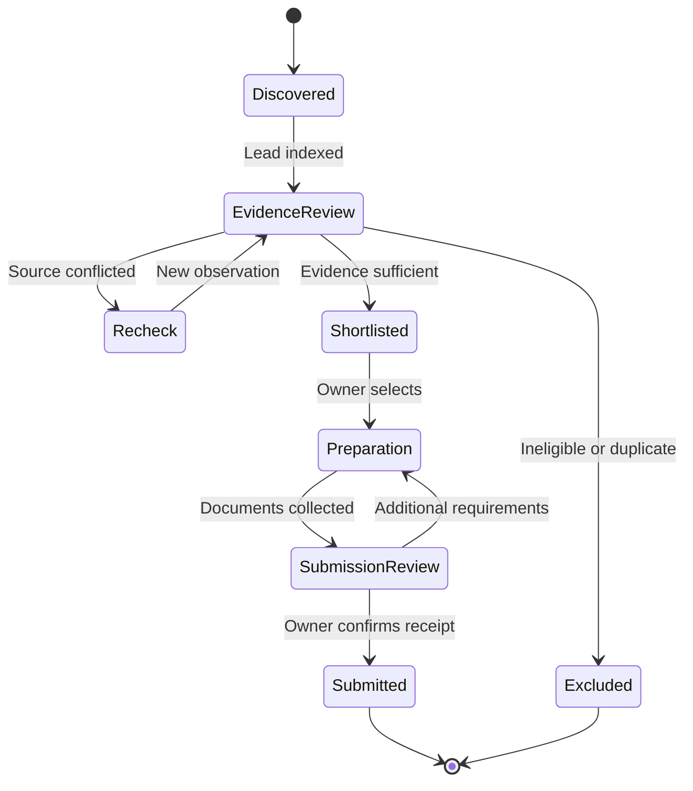

The workflow is a **process model**, not confirmation that tracked applications have been submitted.

</details>

## Research focus quadrant

A transparent, data-based proxy: horizontal position is calendar urgency within 90 days, and vertical position is unresolved document mentions plus explicit proof obligations, divided by eight and capped at one. Neither axis is publication impact or admission probability.

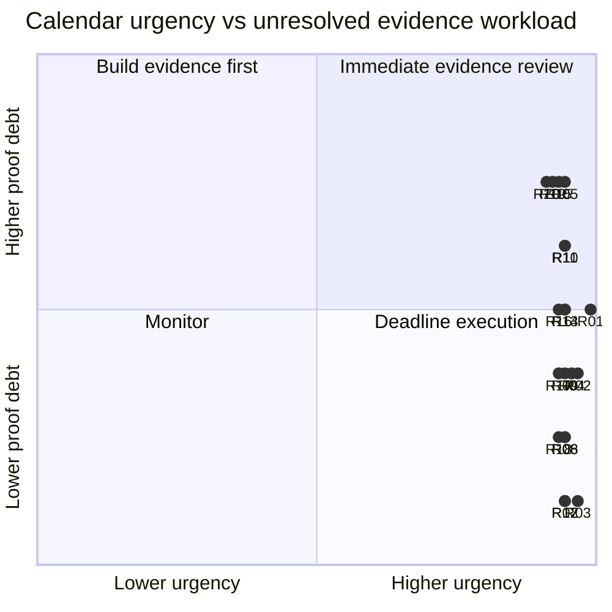

[See application records and exact source IDs](../data/experience_view.json) · [Open the research radar](../data/research_radar.json)

<details>
<summary><b>Research mind map · expand</b></summary>

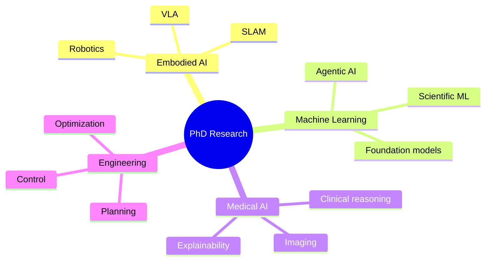

</details>

## Interactive exploration & simulation lab

<table><tr>
<td width="50%" valign="top">
<h3>Interact with actual application data</h3>
<p>Drag and zoom the application-to-document graph, scrub 60 days, tune proof-debt weights, query through the keyboard command palette, move scenario cards, and export CSV/JSON.</p>
<p><b><a href="../dashboard/index.html">Open the self-contained browser application</a></b></p>
</td>
<td width="50%" valign="top">
<h3>Rotate the 3D deadline skyline</h3>
<p>GitHub renders the generated STL as a rotatable 3D model. Five towers encode real counts in the deadline horizon bins, not a fabricated 3D scene.</p>
<p><b><a href="../assets/readme/deadline_skyline.stl">Explore the interactive STL model</a></b></p>
</td>
</tr></table>

## GitHub-native workflow console

The controls below invoke **real GitHub workflows and repository forms**, not inert mock buttons.

| Action | Real execution |
|:--|:--|
| **Run an analysis** | [Open scenario-lab workflow inputs](https://github.com/Armanasq/phd_tracker/actions/workflows/experience-lab.yml) |
| **Update opportunities** | [Run discovery and reconciliation](https://github.com/Armanasq/phd_tracker/actions/workflows/phd-intelligence.yml) |
| **Change owner status** | [Authenticated private issue controls](https://github.com/Armanasq/phd_tracker/issues/1) |
| **Submit an opportunity** | [Structured opportunity issue form](https://github.com/Armanasq/phd_tracker/issues/new?template=02-opportunity-lead.yml) |
| **Correct source evidence** | [Source-correction form](https://github.com/Armanasq/phd_tracker/issues/new?template=01-source-correction.yml) |
| **Propose an automation** | [Automation-idea form](https://github.com/Armanasq/phd_tracker/issues/new?template=03-automation-idea.yml) |
| **Open application tasks** | [Dated execution ledger](../docs/TODAY.md) |
| **Download the tracker** | [Complete workbook](../PhD_Action_List.xlsx) |

[CI checks](https://github.com/Armanasq/phd_tracker/actions/workflows/intelligence-ci.yml) · [Workbook audit](https://github.com/Armanasq/phd_tracker/actions/workflows/audit-workbook.yml) · [README regeneration](https://github.com/Armanasq/phd_tracker/actions/workflows/readme-render.yml) · [JSON evidence](../data/experience_view.json)

## Upcoming application records

| Days left | Deadline | Opportunity | Primary evidence |
|:--|:--|:--|:--|
| **0d** | 2026-11-10 | Swiss Government Excellence Scholarship (research/PhD), 2027-2028 | [Source](https://www.sbfi.admin.ch/scholarships_eng) |
| **3d** | 2026-11-13 | Southampton MSCA BlueOcean PhD Studentship, application 1 of 2: staff vacancy ref 3522426D | [Source](https://jobs.soton.ac.uk/Vacancies.aspx?cat=1065&type=10) |
| **3d** | 2026-11-13 | Inria IROKO Montpellier — PhD Scientific AI and Spatiotemporal Biodiversity Modelling | [Source](https://jobs.inria.fr/public/classic/en/offres/2026-10608) |
| **4d** | 2026-11-14 | TIB Hannover / Leibniz University — Doctoral Researcher in NLP and Causal AI for Scientifi | [Source](https://www.leibniz-gemeinschaft.de/en/careers/jobs/detail/job/show/Job/research-associatedoctoral-researcher-natural-language-processing-and-causal-ai-for-scientific-reasoning-mfd) |
| **5d** | 2026-11-15 | OIST Graduate School PhD, May or Sep 2027 entry (Admissions Workshop 2027) | [Source](https://www.oist.jp/admissions/phd-program/apply-phd) |
| **5d** | 2026-11-15 | Northeastern University London, PhD studentship: Algorithms/Hardware Co-Design for Bayesia | [Source](https://www.jobs.ac.uk/job/DTI287/) |
| **5d** | 2026-11-15 | Institute of Science Tokyo, International Graduate Program IGP(A) Fall 2027 with MEXT reco | [Source](https://admissions.isct.ac.jp/en/013/graduate/programs/igp/igp-a) |

<details>
<summary><b>Advanced visual research laboratory: diagrams and source contracts</b></summary>

The following are generated Mermaid artifacts and can be opened independently on GitHub:

- [Pipeline graph](../docs/diagrams/pipeline.mmd)
- [Deadline Sankey](../docs/diagrams/horizon_sankey.mmd)
- [Application Gantt](../docs/diagrams/deadlines.mmd)
- [Evidence ER model](../docs/diagrams/evidence_erd.mmd)
- [Research quadrant](../docs/diagrams/priority_quadrant.mmd)
- [Application states](../docs/diagrams/application_states.mmd)
- [Agent orchestration](../docs/diagrams/orchestration.mmd)
- [Research mind map](../docs/diagrams/research_map.mmd)
- [Deadline XY chart](../docs/diagrams/deadline_xy.mmd)

[Source data contracts](../data/experience_view.json) · [JSON-LD lineage](../data/experience_lineage.jsonld) · [Architecture](../docs/ARCHITECTURE.md) · [Capability atlas](../docs/CAPABILITY_ATLAS.md) · [Playbooks](../docs/PLAYBOOKS.md)

</details>

<sub>EvidenceGraph · Reproducible · Generated from source data · Observation: 2026-11-10. Research papers are not vacancy notices. Unknown document readiness is not confirmed missing documentation. GitHub README renders Mermaid, GeoJSON and linked STL natively; rich JavaScript interactions run in the downloadable browser application.</sub>


<details>
<summary><b>Engineering detail · execution intelligence and source diagnostics</b></summary>

<div align="center">

<a href="https://github.com/Armanasq/phd_tracker/actions/workflows/experience-lab.yml"></a>

**THIS IS AN EXECUTABLE RESEARCH WORKSPACE, NOT A STATIC TRACKER.**

[**RUN AN INTERACTIVE SCENARIO**](https://github.com/Armanasq/phd_tracker/actions/workflows/experience-lab.yml) · [**OPERATE SOURCE ALERTS**](https://github.com/Armanasq/phd_tracker/issues/1) · [**DOWNLOAD ONE-FILE APP**](../dashboard/index.html) · [**OPENING GUIDE**](../dashboard/README.md) · [**INSPECT RAW EVIDENCE**](../data/experience_view.json)

<sub>Regenerated from committed evidence. Snapshot 2026-11-10 · 107 frontier records · 1 source conflict(s). Real actions run through GitHub or the browser application.</sub>

</div>

## Choose a mode · expand and execute

<table><tr>
<td width="33%" valign="top"><details open><summary><b>01 / SIMULATE</b></summary>

Change horizon, lens and hypothetical document readiness; receive computed ranking and downloadable JSON from a GitHub Actions run.

[**Launch workflow inputs**](https://github.com/Armanasq/phd_tracker/actions/workflows/experience-lab.yml)

</details></td>
<td width="34%" valign="top"><details open><summary><b>02 / INVESTIGATE</b></summary>

Drag evidence nodes, scrub time, tune proof-debt weights, run a command palette and change a local work board.

[**Download executable HTML**](../dashboard/index.html) · [Opening instructions](../dashboard/README.md)

</details></td>
<td width="33%" valign="top"><details open><summary><b>03 / OPERATE</b></summary>

Prioritize, snooze, acknowledge tasks or explicitly set asset readiness with validated source IDs.

[**Owner commands**](https://github.com/Armanasq/phd_tracker/issues/1)

</details></td>
</tr></table>

<a href="https://github.com/Armanasq/phd_tracker/actions/workflows/experience-lab.yml"></a>

## Choose your experiment

<details>
<summary><b>Scenario lab / deadlines, proof debt, documents, research</b></summary>

Open [Run workflow](https://github.com/Armanasq/phd_tracker/actions/workflows/experience-lab.yml), select 7, 14, 30 or 45 days, then choose a deadline, verification, resources or research lens. Optionally enter `academic_cv,research_statement` as hypothetical-ready resources.

The workflow calculates from committed evidence and produces a readable GitHub Actions job summary and JSON artifact. It does not alter application decisions.

</details>

<details>
<summary><b>Temporal graph / drag, zoom, scrub, filter</b></summary>

The [downloadable browser cockpit](../dashboard/index.html) supports a draggable and zoomable evidence graph, 0–60-day time travel, explicit review weights, reproducible URLs, CSV/JSON export, keyboard search (Ctrl/Cmd + K), and a local drag-and-drop workspace.

GitHub README rendering cannot execute JavaScript. Download the generated index.html and open it in a browser: the styles, code and snapshot are embedded in a single file.

</details>

<details>
<summary><b>Document dependencies and emerging research</b></summary>

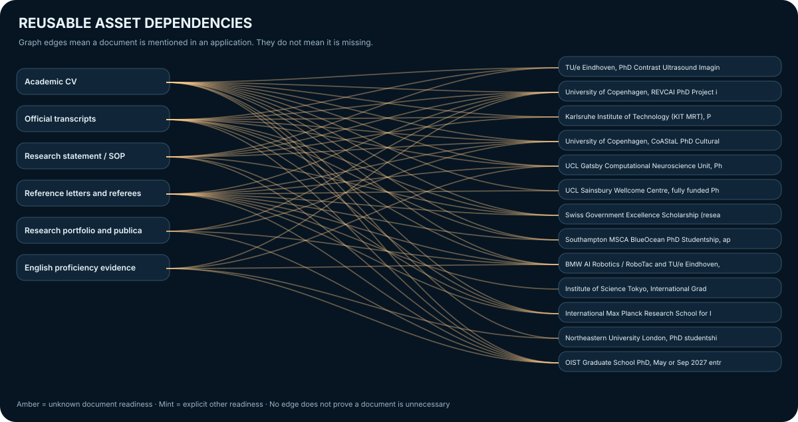

<table><tr><td width="50%">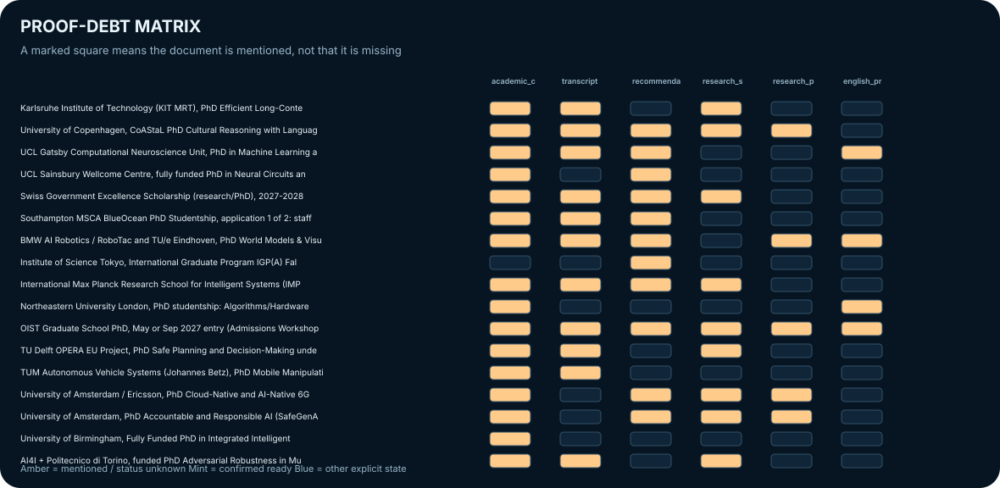</td><td width="50%">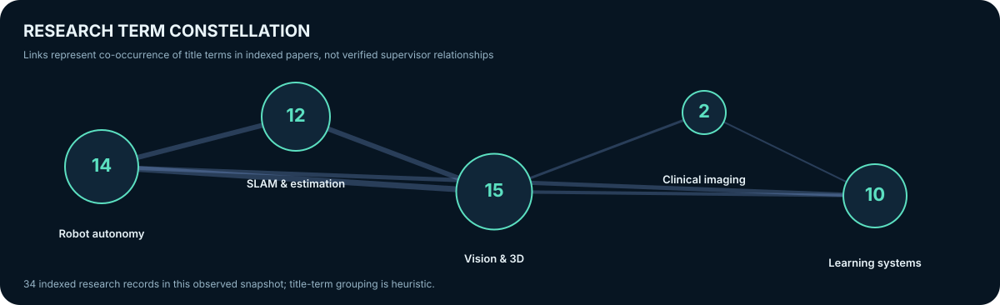</td></tr></table>

Edges encode recorded mentions, not guessed document absence or admission probability.

</details>

<details>
<summary><b>Deadline terrain and discovery source assurance</b></summary>

<table><tr><td width="60%">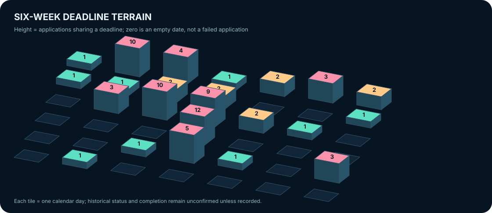</td><td width="40%">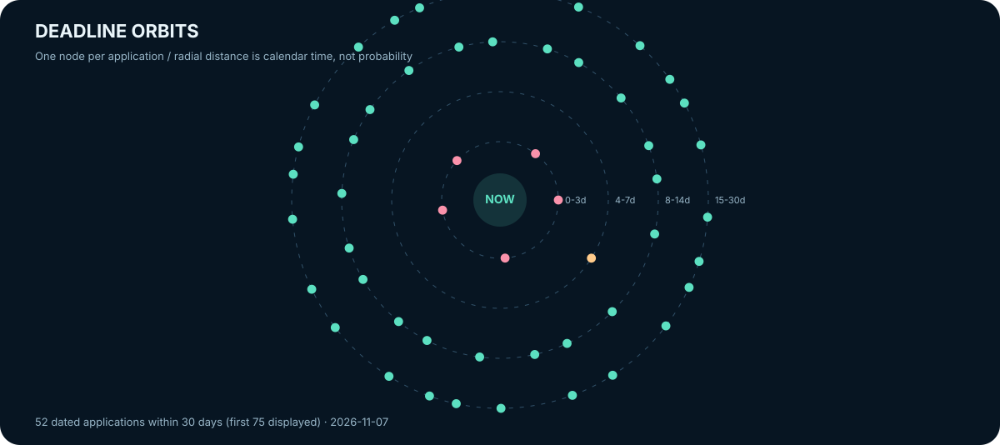</td></tr></table>

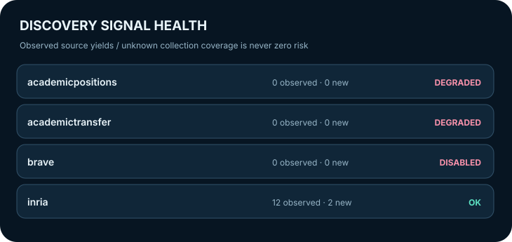

[Monitor observations](../data/latest_run.json) · [Discovery diagnostics](../data/discovery_report.json) · [Portfolio frontier](../data/portfolio_frontier.json) · [Provenance JSON-LD](../data/experience_lineage.jsonld)

</details>

## Upcoming records · observation 2026-11-10

| Horizon | Date | Application | Primary source |
|:--|:--|:--|:--|
| **0d** | 2026-11-10 | Swiss Government Excellence Scholarship (research/PhD), 2027-2028 | [Evidence](https://www.sbfi.admin.ch/scholarships_eng) |
| **3d** | 2026-11-13 | Inria IROKO Montpellier — PhD Scientific AI and Spatiotemporal Biodiversity Modelling | [Evidence](https://jobs.inria.fr/public/classic/en/offres/2026-10608) |
| **3d** | 2026-11-13 | Southampton MSCA BlueOcean PhD Studentship, application 1 of 2: staff vacancy ref 3522426DA (jobs.soton.ac.uk) | [Evidence](https://jobs.soton.ac.uk/Vacancies.aspx?cat=1065&type=10) |
| **4d** | 2026-11-14 | TIB Hannover / Leibniz University — Doctoral Researcher in NLP and Causal AI for Scientific Reasoning (EcoAIRE | [Evidence](https://www.leibniz-gemeinschaft.de/en/careers/jobs/detail/job/show/Job/research-associatedoctoral-researcher-natural-language-processing-and-causal-ai-for-scientific-reasoning-mfd) |
| **5d** | 2026-11-15 | BMW AI Robotics / RoboTac and TU/e Eindhoven, PhD World Models &amp; Visuo-Tactile Foundation Models (2 research t | [Evidence](https://www.robotac.eu/open-positions) |
| **5d** | 2026-11-15 | Institute of Science Tokyo, International Graduate Program IGP(A) Fall 2027 with MEXT recommendation | [Evidence](https://admissions.isct.ac.jp/en/013/graduate/programs/igp/igp-a) |
| **5d** | 2026-11-15 | International Max Planck Research School for Intelligent Systems (IMPRS-IS), 2027 doctoral recruitment | [Evidence](https://imprs.is.mpg.de/application) |
| **5d** | 2026-11-15 | Northeastern University London, PhD studentship: Algorithms/Hardware Co-Design for Bayesian and Ising Models ( | [Evidence](https://www.jobs.ac.uk/job/DTI287/) |

[Complete action agenda](../docs/TODAY.md) · [Workbook](../PhD_Action_List.xlsx) · [Calendar feed](../calendar/phd_deadlines.ics)

<details>
<summary><b>Reproduce, verify and operate the system</b></summary>

Submission deadlines and preparation tasks are different. A source assertion is not proof of eligibility. A document mention is not evidence that it is missing. A research paper is not an open funded PhD position. Hypothetical readiness is not recorded applicant status.

[Architecture](../docs/ARCHITECTURE.md) · [Capability atlas](../docs/CAPABILITY_ATLAS.md) · [Playbooks](../docs/PLAYBOOKS.md) · [Source correction](https://github.com/Armanasq/phd_tracker/issues/new?template=01-source-correction.yml) · [New opportunity intake](https://github.com/Armanasq/phd_tracker/issues/new?template=02-opportunity-lead.yml) · [Propose an experiment](https://github.com/Armanasq/phd_tracker/issues/new?template=03-automation-idea.yml)

These are working combinations of existing interaction methods; no unverified claim of globally unprecedented invention is made.

</details>


<div align="center">

**EVIDENCEGRAPH · PhD APPLICATION INTELLIGENCE**

*Every deadline is dated. Every uncertainty is visible. Every decision links to evidence.*

[](https://github.com/Armanasq/phd_tracker/actions/workflows/phd-intelligence.yml)
[](https://github.com/Armanasq/phd_tracker/actions/workflows/intelligence-ci.yml)
[](https://github.com/Armanasq/phd_tracker/actions/workflows/audit-workbook.yml)

[**APPLICATION WORKSPACE**](../PhD_Action_List.xlsx) · [**DEADLINE OPERATIONS**](../docs/TODAY.md) · [**BROWSER FLIGHT DECK**](../dashboard/README.md) · [**SOURCE PROVENANCE**](../data/experience_lineage.jsonld) · [**OWNER COMMANDS**](https://github.com/Armanasq/phd_tracker/issues/1)

</div>

### Navigate the command center

[**01 · Act now**](#01--execute--2026-11-10) · [**02 · Decide next**](#02--next-decisions-not-just-a-countdown) · [**03 · Verify sources**](#03--evidence-backed-search-and-auditability) · [**04 · Data model**](#04--all-worksheets-participate) · [**05 · Controls**](#05--github-as-a-private-operating-interface) · [**06 · Engineering**](#06--research-contributions-not-cosmetic-features)

| Priority | Immediate route | Outcome |
|:--|:--|:--|
| **Submit / verify** | [Open today’s 1 application deadline(s)](../docs/TODAY.md) | Prevent missing a final deadline; confirm portal status and submission receipts |
| **Plan the workload** | [Today's execution plan](../docs/TODAY.md) | Separate actual application deadlines from supporting steps and shared tasks |
| **Resolve uncertainty** | [Review proof obligations](../data/portfolio_frontier.json) | Identify funding restrictions, portal contradictions, and missing evidence |
| **Explore opportunities** | [Discovery inbox](../data/discovered_candidates.json) | Evaluate new leads before any promotion into the application list |
| **Operate reminders** | [Private Action Center](https://github.com/Armanasq/phd_tracker/issues/1) | Mark tasks done, explicitly declare asset readiness, or snooze noncritical alerts |

#### Live operational signals (committed snapshot)

| Time critical | Source assurance | Applicant decisions | Research horizon |
|:--|:--|:--|:--|
| **2** deadline(s) in ≤3 days; **18** in the next 7 days | **1/4** active providers reporting healthy; **3** degraded/disabled | **29** dated steps today; **118** older steps with *completion unknown* | **68** indexed papers, research signals only |
| [Review every dated task](../docs/TODAY.md) | [Source diagnostics](../data/discovery_report.json) | [Confirm task status](https://github.com/Armanasq/phd_tracker/issues/1) | [Research radar](../data/research_radar.json) |

**Source consistency:** 7 observations across 7 configured monitors; 5 matched expected anchors and 2 require review. **Degraded sources:** academicpositions, academictransfer, brave.

<sub>Last official-page monitor: 2026-11-10 · last discovery: 2026-11-10 · last publication radar: 2026-11-10. These are observed snapshots, not live counters or a guarantee that any position is still accepting applicants.</sub>

> [!IMPORTANT]
> **Observed snapshot: 2026-11-10 (Europe/Berlin).** Application deadlines, step dates and shared tasks are different data types. A task dated in the past is **completion-unconfirmed**, not automatically unfinished. Original verdicts are research assessments, not confirmed submission receipts. Primary sources determine final eligibility and deadlines.

<a href="../docs/TODAY.md">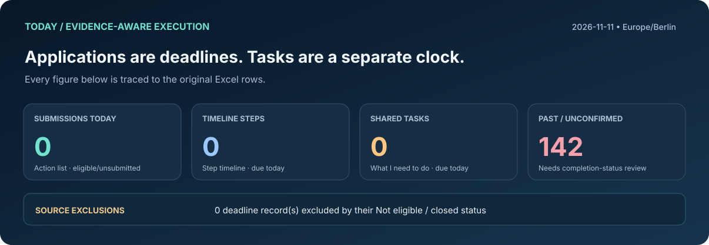</a>

## Explore EvidenceGraph by outcome

<a href="../docs/CAPABILITY_ATLAS.md">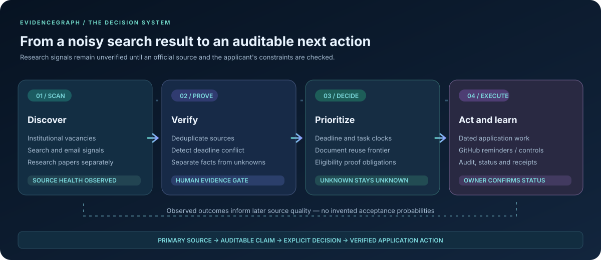</a>

<table>
<tr>
<td width="33%" valign="top">

### Find a doctoral position

**Discover → verify → shortlist**

[Research queue](../data/discovered_candidates.json) · [Search diagnostics](../data/discovery_report.json)

Identify original institutional postings, duplicate URLs, uncertain eligibility, source failures and deadline contradictions. Never confuse a research paper with an open funded position.

</td>
<td width="33%" valign="top">

### Execute an application

**Plan → prepare → submit**

[Today's action plan](../docs/TODAY.md) · [Portfolio frontier](../data/portfolio_frontier.json)

Separate actual final deadlines from preparation steps, identify reusable materials and explicitly confirm statuses. An unknown task or asset state is not automatically classified as incomplete.

</td>
<td width="34%" valign="top">

### Operate the intelligence system

**Monitor → alert → improve**

[Private Action Center](https://github.com/Armanasq/phd_tracker/issues/1) · [Live workflow](https://github.com/Armanasq/phd_tracker/actions/workflows/phd-intelligence.yml)

Review source conflicts, snooze or prioritize individual applications and inspect coverage. Gmail and external alerts require configured credentials.

</td>
</tr>
</table>

| Want to... | Open this surface |
|:--|:--|
| Understand every available capability and its maturity | [Capability atlas — operational, conditional, degraded, proposed](../docs/CAPABILITY_ATLAS.md) |
| Follow a complete real-world operating procedure | [Nine scenario playbooks](../docs/PLAYBOOKS.md) |
| Report a changed deadline or closed portal | [Structured source correction](https://github.com/Armanasq/phd_tracker/issues/new?template=01-source-correction.yml) |
| Submit a new PhD lead for human verification | [Structured opportunity intake](https://github.com/Armanasq/phd_tracker/issues/new?template=02-opportunity-lead.yml) |
| Propose an experiment with metrics and rollback | [Automation experiment form](https://github.com/Armanasq/phd_tracker/issues/new?template=03-automation-idea.yml) |
| Compare engineering intent with actual implementation | [System architecture](../docs/ARCHITECTURE.md) · [Product RFC](../docs/PRODUCT_RFC.md) |
| Inspect tests, provider failures and data lineage | [Regression CI](https://github.com/Armanasq/phd_tracker/actions/workflows/intelligence-ci.yml) · [Evidence diagnostics](../data/discovery_report.json) |

> [!NOTE]
> **Capability transparency:** Inria discovery and private GitHub reminders are operating. AcademicPositions is currently blocked (HTTP 403), AcademicTransfer has zero observed records, and Brave search requires an API key. External notifications, Gmail polling and Google Sheets synchronization are not claimed to be active without their respective configuration. The operational snapshot above is dated and must not be interpreted as real-time eligibility proof.

## 01 · Execute — 2026-11-10

### Submission deadlines today — 1 actionable · 0 explicitly excluded

| When | Application / workstream | Action | Source |
|:--|:--|:--|:--|
| 2026-11-10 | Swiss Government Excellence Scholarship (research/PhD), 2027-2028 | By 29 Oct 2026: email sgs@sbfi.admin.ch asking Iran's scholarship type and deadline and whether an Iranian resident in Turkey applies via Tehran or Ankara route | [Source page](https://www.sbfi.admin.ch/scholarships_eng) · Action list · row 37 |

### Cross-route work — 2 scheduled today

| Date | Cross-application task | Recorded status |
|:---|:---|:---|
| 2026-11-10 | Settle English tests: UBC wants overall 7 with no band below 6; York asks IELTS 7; Waterloo mentions an 83% equivalency. Book the retest if any band is below the minimum, so the result exists before the 1 to 15 Dec deadlines. · `tsk-78e48091bb3c011d` | To do |
| 2026-11-10 | Confirm separate Southampton BlueOcean linked project form and ref 3522426DA eligibility; official staff deadline now 13 Nov. · `tsk-4dc7498def77cbd7` | To do |

**Programme-specific steps due today** — 29 distinct records from the *Step timeline* worksheet, not inferred from the final submission date.

| When | Application / workstream | Action | Source |
|:--|:--|:--|:--|
| 2026-11-10 | Swiss Government Excellence Scholarship (research/PhD), 2027-2028 | By 29 Oct 2026: email sgs@sbfi.admin.ch asking Iran's scholarship type and deadline and whether an Iranian resident in Turkey applies via Tehran or Ankara route · `tsk-f4d413183cd2f563` | [Source page](https://www.sbfi.admin.ch/scholarships_eng) · Step timeline · row 228 |
| 2026-11-10 | Swiss Government Excellence Scholarship (research/PhD), 2027-2028 | By 3 Nov 2026: obtain support letter from a Swiss professor (no help from ESKAS or universities) with their 2-page CV · `tsk-4fa2304d7439fb0f` | [Source page](https://www.sbfi.admin.ch/scholarships_eng) · Step timeline · row 229 |
| 2026-11-10 | Swiss Government Excellence Scholarship (research/PhD), 2027-2028 | Register in GO ESKAS; ask two professors to upload recommendation letters · `tsk-a078da51c1ff7bec` | [Source page](https://www.sbfi.admin.ch/scholarships_eng) · Step timeline · row 230 |
| 2026-11-10 | Swiss Government Excellence Scholarship (research/PhD), 2027-2028 | Before the country deadline: upload CV, 2-page motivation letter, 5-page research proposal on ESKAS form, certificates and transcripts, passport copy · `tsk-ef50fe89bd1641d1` | [Source page](https://www.sbfi.admin.ch/scholarships_eng) · Step timeline · row 231 |
| 2026-11-10 | Southampton MSCA BlueOcean PhD Studentship, application 1 of 2: staff vacancy ref 3522426DA (jobs.soton.ac.uk) | Confirm whether BlueOcean linked doctoral project application is required separately, and verify its independent deadline before 13 Nov staff deadline. · `tsk-33738d53760b564a` | [Source page](https://jobs.soton.ac.uk/Vacancies.aspx?cat=1065&type=10) · Step timeline · row 226 |
| 2026-11-10 | Southampton MSCA BlueOcean, application 2 of 2: linked PhD 'Robotic monitoring for place recognition and change detection in  | Verify BlueOcean linked PhD/project form requirements and deadline; earlier 31 Oct date is superseded for staff role but not verified for linked form. · `tsk-c7f9dc906967952d` | [Source page](https://www.jobs.ac.uk/job/DTE958/) · Step timeline · row 227 |
| 2026-11-10 | OIST Graduate School PhD, May or Sep 2027 entry (Admissions Workshop 2027) | By 2026-11-10 confirm at least 2 recommendation letters have arrived · `tsk-7bd20d737d29c4d9` | [Source page](https://www.oist.jp/admissions/phd-program/apply-phd) · Step timeline · row 224 |
| 2026-11-10 | NTNU Gjovik, Ph.D. Candidate in Reinforcement Learning for Project Scheduling Problems (Jobbnorge 310778) | By 2026-11-10 write the project outline (max 1,500 words / 4 pages) and motivation letter (max 400 words / 1 page) · `tsk-51dc08e338c5d73d` | [Source page](https://www.jobbnorge.no/en/available-jobs/joblisting/pdf/310778) · Step timeline · row 223 |
| 2026-11-10 | University of Oslo, PhD Research Fellow in Control Theory and Optimization for Edge Computing (Jobbnorge 310583) | By 2026-11-10 line up 2-3 referees with name, relation, email and phone; prepare publication list and cover letter · `tsk-b5f721e9c0b06b94` | [Source page](https://www.jobbnorge.no/en/available-jobs/joblisting/pdf/310583) · Step timeline · row 237 |
| 2026-11-10 | OsloMet PhD Fellow in Trustworthy Generative AI with Knowledge Verification (310467) | By 2026-11-10: assemble application letter, CV, all pages of BSc and MSc diplomas/certificates, MSc thesis, publication list, links to articles · `tsk-7079e73d73cf6818` | [Source page](https://www.oslomet.no/en/work/job-openings/phd-fellow-in-trustworthy-generative-ai-with-knowledge-verification) · Step timeline · row 225 |
| 2026-11-10 | Mila supervision request (up to three professors) plus separate university application | Create/log in to MyMila applicant portal and shortlist up to three Mila core/associate professors by 2026-11-10 · `tsk-9f9afec0124df9b8` | [Source page](https://mila.quebec/en/supervision-requests/) · Step timeline · row 219 |
| 2026-11-10 | Mila supervision request (up to three professors) plus separate university application | Prepare and submit the separate application to each professor's partner university/school (deadline set by that university; not on Mila page) - check by 2026-11-10 · `tsk-435de96aadd0e1ea` | [Source page](https://mila.quebec/en/supervision-requests/) · Step timeline · row 220 |

<details>
<summary><b>Show every scheduled task today, the unconfirmed backlog, and exclusion reasons</b></summary>

The full execution queue preserves original worksheet row numbers and source IDs. No completion status is invented for the Step timeline.

[Open full, source-linked agenda](../docs/TODAY.md) · [Inspect machine-readable plan](../data/execution_plan.json) · [Open editable Task ledger](../PhD_Action_List.xlsx)

**Not actionable today**

No exclusions on this date.

**Earlier dates with completion unconfirmed:** 118 tasks. 14 are cross-route tasks and 104 are programme timeline steps. They are **not automatically treated as outstanding** until the user confirms progress.

</details>

<a href="../docs/TODAY.md">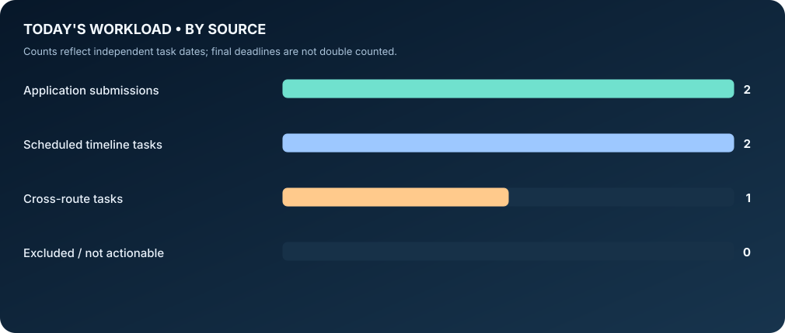</a>

## 02 · Next decisions, not just a countdown

**Application deadlines during the next seven days (18)**

| When | Application / workstream | Action | Source |
|:--|:--|:--|:--|
| 2026-11-13 | Southampton MSCA BlueOcean PhD Studentship, application 1 of 2: staff vacancy ref 3522426DA (jobs.soton.ac.uk) | By 13 Nov 23:59 UK time: submit BlueOcean MSCA staff vacancy ref 3522426DA via jobs.soton.ac.uk. Also confirm and complete any separate PhD/project registration (linked form timing not verified). | [Source page](https://jobs.soton.ac.uk/Vacancies.aspx?cat=1065&type=10) · Action list · row 39 |
| 2026-11-13 | Inria IROKO Montpellier — PhD Scientific AI and Spatiotemporal Biodiversity Modelling | Check research scope and applicant eligibility, then submit directly via Inria portal by 13 Nov; demonstrate reproducible scientific ML and physics-informed modelling experience. | [Source page](https://jobs.inria.fr/public/classic/en/offres/2026-10608) · Action list · row 38 |
| 2026-11-14 | TIB Hannover / Leibniz University — Doctoral Researcher in NLP and Causal AI for Scientific Reasoning (EcoAIRE), 44/2026 | Apply by 14 Nov using official online form, reference 44/2026. Focus application on evidence-grounded agent architectures, causal research extraction, knowledge graphs and robust RAG/LLM evaluation; confirm con | [Source page](https://www.leibniz-gemeinschaft.de/en/careers/jobs/detail/job/show/Job/research-associatedoctoral-researcher-natural-language-processing-and-causal-ai-for-scientific-reasoning-mfd) · Action list · row 40 |
| 2026-11-15 | OIST Graduate School PhD, May or Sep 2027 entry (Admissions Workshop 2027) | By 2026-10-29 browse faculty and units (including Yamada MLDS and Pao Chan units) at https://www.oist.jp/research/faculty-members and check supervisor availability at https://www.oist.jp/admissions/phd-program/ | [Source page](https://www.oist.jp/admissions/phd-program/apply-phd) · Action list · row 45 |
| 2026-11-15 | Northeastern University London, PhD studentship: Algorithms/Hardware Co-Design for Bayesian and Ising Models (Rajendran; ref  | By 2026-10-29 email b.rajendran@nulondon.ac.uk with a short informal enquiry (confirm post still open given rolling shortlisting; ask about visa) | [Source page](https://www.jobs.ac.uk/job/DTI287/) · Action list · row 44 |
| 2026-11-15 | Institute of Science Tokyo, International Graduate Program IGP(A) Fall 2027 with MEXT recommendation | By 2026-10-29 download the IGP(A) application guide PDF from the info_url page and read it (the page says applicants must always refer to it); identify a theme/programme (PSIL, IPSSS, eMAT, Sustainable Bio-Econ | [Source page](https://admissions.isct.ac.jp/en/013/graduate/programs/igp/igp-a) · Action list · row 42 |
| 2026-11-15 | TUM Autonomous Vehicle Systems (Johannes Betz), PhD Mobile Manipulation for Humanoid Robots | Submit complete documents by email to application.avs@ed.tum.de by 15 Nov. Ask whether German fluency is genuinely mandatory. | [Source page](https://www.mos.ed.tum.de/en/avs/career/our-jobs/ki-motorsport-1/) · Action list · row 47 |
| 2026-11-15 | TU Delft OPERA EU Project, PhD Safe Planning and Decision-Making under Uncertainty for Long-Horizon Robot Autonomy | Apply through TU Delft careers portal by 15 Nov; show formal planning/control and empirical robotics contributions. | [Source page](https://www.academictransfer.com/nl/jobs/365008/phd-position-safe-planning-and-decision-making-under-uncertainty-for-long-horizon-robot-autonomy/) · Action list · row 46 |
| 2026-11-15 | International Max Planck Research School for Intelligent Systems (IMPRS-IS), 2027 doctoral recruitment | Apply by 15 Nov end of day Anywhere on Earth (AoE); select eligible primary faculty and tailor motivation. Stuttgart SIR openings may be accessed via this SAME application. | [Source page](https://imprs.is.mpg.de/application) · Action list · row 43 |
| 2026-11-15 | BMW AI Robotics / RoboTac and TU/e Eindhoven, PhD World Models & Visuo-Tactile Foundation Models (2 research topics) | Apply by 15 Nov 2026 to robotac@bmw.de with single English PDF: CV, max 1-page letter, BSc/MSc transcripts, two references, publications. | [Source page](https://www.robotac.eu/open-positions) · Action list · row 41 |
| 2026-11-15 | University of Birmingham, Fully Funded PhD in Integrated Intelligent Safe Environment (IISE) for Nuclear Robotics | Before applying, ask Dr Davis whether Iranian nationality and degree meet project/UK nuclear-security eligibility; email CV and 0.5-page fit summary by 15 Nov if allowed. | [Source page](https://www.jobs.ac.uk/job/DTM113/phd-studentship-phd-in-an-integrated-intelligent-safe-environment-iise-in-the-nuclear-industry) · Action list · row 50 |
| 2026-11-15 | University of Amsterdam, PhD Accountable and Responsible AI (SafeGenAI / LLM4LM; #15581) | Apply promptly; UvA may close before 15 Nov if a candidate is selected. Specify evidential grounding, source traceability and evaluation. | [Source page](https://werkenbij.uva.nl/en/vacancies/phd-position-in-accountable-and-responsible-ai-netherlands-15581) · Action list · row 49 |
| 2026-11-15 | University of Amsterdam / Ericsson, PhD Cloud-Native and AI-Native 6G Networks (#15041) | Check if domain and foreign MSc meet criteria before drafting; if so submit by 15 Nov. | [Source page](https://werkenbij.uva.nl/en/vacancies/phd-position-in-cloud-native-and-ai-native-6g-networks-netherlands-15041) · Action list · row 48 |
| 2026-11-16 | NTNU Gjovik, Ph.D. Candidate in Reinforcement Learning for Project Scheduling Problems (Jobbnorge 310778) | By 2026-10-30 email Yongping Liu with a short enquiry and CV | [Source page](https://www.jobbnorge.no/en/available-jobs/joblisting/pdf/310778) · Action list · row 54 |
| 2026-11-16 | AI4I + Politecnico di Torino, funded PhD Agentic System-1/System-2 Architectures for Robot Autonomy | Submit expression of interest plus separate formal Apply@polito doctoral application no later than 16 Nov 14:00 CET. | [Source page](https://ai4i.it/phd-position-on-agentic-and-system-1system-2-architectures-for-robot-autonomy/) · Action list · row 52 |
| 2026-11-16 | AI4I + Politecnico di Torino, funded PhD Adversarial Robustness in Multimodal Foundation Models | Select Computer Engineering and Systems doctoral call and submit formal PoliTo application by 16 Nov 14:00 CET; align vision/audio/LLM work with multimodal safety. | [Source page](https://ai4i.it/phd-position-on-adversarial-robustness-in-multi-modal-foundation-models/) · Action list · row 51 |
| 2026-11-16 | AI4I and Politecnico di Torino — PhD Trustworthy Generalist Robot Policies | Submit BOTH the Politecnico di Torino official PhD admission application and the AI4I expression of interest; finish by 16 Nov 14:00 CET. Tailor research statement to runtime assurance, safe adaptation, world m | [Source page](https://ai4i.it/open-calls/phd-position-on-trustworthy-generalist-robot-policies/) · Action list · row 53 |
| 2026-11-17 | University of Oslo, PhD Research Fellow in Control Theory and Optimization for Edge Computing (Jobbnorge 310583) | By 2026-10-30 email Mathias Hudoba de Badyn (and optionally Tonnes Nygaard) with CV and a short enquiry | [Source page](https://www.jobbnorge.no/en/available-jobs/joblisting/pdf/310583) · Action list · row 55 |

| Operating surface | Open | Decision supported |
|:--|:--|:--|
| **Execution board** | [Workbook](../PhD_Action_List.xlsx) | Due tasks separated by source, date, eligibility and status |
| **Full Task ledger** | [Workbook](../PhD_Action_List.xlsx) | Every application deadline and every programme/shared task with provenance |
| **Calendar reminders** | [Download ICS](../calendar/phd_deadlines.ics) | Import all-day reminders for future tasks and deadlines; reimport when the workbook changes |
| **Deadline and proof obligations** | [Decision frontier](../data/portfolio_frontier.json) | Funding/eligibility contradictions and reusable-document dependencies |
| **Review queue** | [Research queue](../data/discovered_candidates.json) | Search leads needing official source confirmation |
| **Live notifications** | [Private Action Center](https://github.com/Armanasq/phd_tracker/issues/1) | Reminder history, conflicts and owner controls |
| **Academic trajectory** | [Research radar](../data/research_radar.json) | Relevant papers for research positioning, not jobs |

## 03 · Evidence-backed search and auditability

<div align="center">
<a href="../data/discovery_report.json">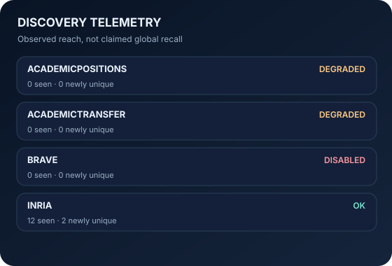</a>
<a href="../assets/readme/horizon.svg">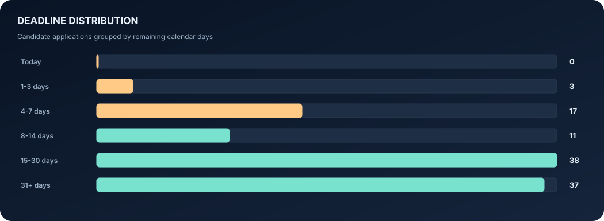</a>
</div>

| Search provider | Health | Observed | New unique |
|:--|:--|--:|--:|
| academicpositions | degraded | 0 | 0 |
| academictransfer | degraded | 0 | 0 |
| brave | disabled | 0 | 0 |
| inria | ok | 10 | 0 |

- **Contradictory source observations:** 2 monitor finding(s). A published programme deadline is not proof that an application portal is accepting submissions.
- **Research records:** 68 scholarly articles indexed separately, not counted as available PhD placements.
- **Discovery scope:** without configured Brave credentials, international web search is **disabled**. A healthy workflow cannot imply exhaustive worldwide coverage.

<details>
<summary><b>Research claims, exclusions and source integrity</b></summary>

The original *Dropped* and *Not added* tabs retain **6 dropped routes** and **200 researched-but-not-added routes**. They are an evidence base for explaining omissions, not proof that those programmes are permanently unsuitable.

The automated research queue contains 43 rows. Review both university vacancy records and eligibility/funding requirements before promoting a result to the main list. Historical exclusions have **0 possible reappearance warning(s)**, which require manual review rather than automatic rejection.

[Source provenance](../data/latest_run.json) · [Discovery report](../data/discovery_report.json) · [Historical exclusion memory](../data/exclusion_memory.json) · [Rejected and unadded decisions](../PhD_Action_List.xlsx) · [Detailed methodology](../docs/PRODUCT_RFC.md)

</details>

## 04 · All worksheets participate

The system is not limited to the deadline column. These sheets are retained in the repository workbook and have distinct operational roles.

| Worksheet | Role in the workflow |
|:--|:--|
| **Read me** | Original tracker documentation, eligibility and verdict rules |
| **Action list** | Master application records, verdicts, dates, funding, blockers and links |
| **Step timeline** | Dated programme-specific preparation and submission tasks |
| **What I need to do** | Cross-route checklist and user-maintained task statuses |
| **Dropped** | Rejected or inaccessible routes with source-specific reasons |
| **Not added** | Investigated leads deliberately excluded from the main list |
| **Research queue** | Discovered leads awaiting funding, eligibility and deadline review |
| **Mail signals** | Evidence extracted from personally reviewed recruitment correspondence |
| **Evidence ledger** | Source, observation date and proof of claims |
| **Source watch** | Website change and contradictory portal monitoring |
| **Decision frontier** | Application readiness uncertainty, proof debt and reusable assets |
| **Research radar** | Related publications only, never misclassified as vacancies |
| **Execution board** | Prioritized view of scheduled submissions and preparation tasks |
| **Task ledger** | Every dated programme task and original worksheet row, not just deadlines |
| **Exclusion memory** | Historical dropped and not-added evidence; reappearing leads are flagged, never silently rejected |

**Original workbook coverage:** 194 applications · 570 dated/programme-specific steps · 26 shared tasks · 6 dropped routes · 200 researched but unadded.

The generated **Execution board** and **Task ledger** can be filtered or edited locally. Derived sheets are regenerated; original source sheets and status cells are protected by integrity tests.

## 05 · GitHub as a private operating interface

<details open>
<summary><b>Owner-only interactive commands</b></summary>

Comment on [PhD Intelligence — Action Center](https://github.com/Armanasq/phd_tracker/issues/1):

```text
/priority N263-02
/snooze N263-02 3d
/unsnooze N263-02
/mute N263-02
/unmute N263-02
/asset academic_cv ready
/asset research_statement in_progress
/asset transcripts unknown
/done tsk-<copy-task-id-from-daily-agenda>
/reopen tsk-<copy-task-id-from-daily-agenda>
```

Commands are validated against the repository owner, known source IDs, allowed states and stable task IDs. Use a real `tsk-...` identifier printed beside each programme/shared task in the agenda; `/done` and `/reopen` update a private completion overlay, regenerate the workbook/README and never alter original submission states. Comments are idempotent by ID and acknowledged after successful commits. Same-day and next-day deadlines cannot be muted.

**Resource readiness is never inferred from advertised requirements.** Update it explicitly, or retain the default `unknown`.

</details>

<details>
<summary><b>Advanced automation, integrations and scheduling</b></summary>

| Workflow | Trigger | Produces |
|:--|:--|:--|
| [Intelligence pipeline](../.github/workflows/phd-intelligence.yml) | Twice daily and manually | Discovery, evidence reconciliation, workbook, README and notifications |
| [Workbook audit](../.github/workflows/audit-workbook.yml) | Workbook-auditor changes or manually | Cross-tab inventory and date integrity |
| [Security and regression CI](../.github/workflows/intelligence-ci.yml) | Code changes | Parser, deadline, snapshot and interaction tests |
| [Private issue commands](../.github/workflows/issue-controls.yml) | Owner-created Issue comment | Priority, snooze, mute or explicit resource status |
| [Manual fallback](../.github/workflows/refresh-tracker.yml) | On demand | Evidence-watch refresh |

Optional secrets are `BRAVE_SEARCH_API_KEY` (broad discovery), `GMAIL_CLIENT_ID`, `GMAIL_CLIENT_SECRET` and `GMAIL_REFRESH_TOKEN` (read-only email metadata), and `APPRISE_URLS` (external notifications). Without them, the corresponding capabilities are disabled rather than simulated.

</details>

<details>
<summary><b>System design, data lineage and state transitions</b></summary>

```mermaid
flowchart TD
    A["University vacancy sources"] --> C["Canonical identity & assertion ledger"]
    B["Optional broad research + Gmail metadata"] --> C
    X["arXiv research papers"] --> Y["Research context only"]
    C --> QPrimary evidence and eligibility verified?
    Q -->|"No"| R["Research queue + proof debt"]
    Q -->|"Yes, after review"| E["Excel Action list"]
    E --> T["Step timeline · dated tasks"]
    E --> D["Deadlines · applicant status"]
    G["What I need to do"] --> O["Full task planner"]
    T --> O
    D --> O
    H["Dropped / Not added"] --> O
    O --> U["Execution board + Task ledger"]
    O --> N["Action Center + deduplicated reminders"]
    Y --> N
    N --> V["Explicit owner commands"]
    V --> O
```

The engine cannot submit applications, invent funding eligibility, silently change a user decision, or execute arbitrary commands from third-party search content. Data merges are re-evaluated against current `main` to avoid binary workbook conflicts.

</details>

## From a GitHub repository to an operating system

<details>
<summary><b>Use case A — an application closes today</b></summary>

**Deadline → application portal → explicit verification → preparation steps → receipt.** Start with [today's execution plan](../docs/TODAY.md), inspect the primary source, verify the time zone, and submit directly to the university. The system records a deadline and tasks; it **does not** confirm that the application was submitted. Only a portal receipt or your explicit decision can establish that state.

</details>

<details>
<summary><b>Use case B — a recruiting lab publishes a contradictory deadline</b></summary>

**Evidence comparison → proof debt → human resolution.** The [source monitor](../data/latest_run.json) checks observed institutional assertions. A closed application portal does not automatically overwrite an advertised deadline; the contradiction appears in the [decision frontier](../data/portfolio_frontier.json) and the [Action Center](https://github.com/Armanasq/phd_tracker/issues/1).

</details>

<details>
<summary><b>Use case C — a single document is needed for multiple applications</b></summary>

**Reusable document → explicit readiness → deadline dependency.** Review [document leverage](../data/portfolio_frontier.json) and set your real state in the [Action Center](https://github.com/Armanasq/phd_tracker/issues/1), for example `/asset research_statement in_progress`. Mentions of a CV, statement, or transcript in vacancy text are **not** proof that you lack the document.

</details>

<details>
<summary><b>Use case D — find a lab before an official vacancy exists</b></summary>

The [research radar](../data/research_radar.json) monitors topical publications in robotics, vision, medical AI and related areas. Research papers provide context for prospective supervisors and SOP positioning; they are **not** interpreted as funded openings. The [discovery pipeline](../.github/workflows/phd-intelligence.yml) independently monitors actual vacancies, with source limitations disclosed.

</details>

### Delivery truth table

| Capability | Current implementation | Trust boundary |
|:--|:--|:--|
| Scheduled search | Twice-daily matrix of institutional/marketplace connectors | A source may fail, block crawlers, or return no results |
| Deadline-driven execution | Separate final deadlines, programme steps and shared tasks | Past completion is unknown unless explicitly recorded |
| Opportunity reconciliation | Canonical URL deduplication, source history and review queue | Search snippets never prove funding or eligibility |
| Repository notifications | Owner-assigned Issue and threshold-based reminders | Notification delivery outside GitHub needs an opt-in endpoint |
| Interactive commands | Owner-scoped task, asset and alert controls | Neither a GitHub comment nor a scraped page executes arbitrary shell commands |
| Email intelligence | Existing reviewed signals; optional OAuth metadata intake | Gmail automation requires separately configured read-only credentials |
| Research radar | arXiv publications displayed apart from vacancy records | Papers do not establish a recruiting PhD position |
| Workbook integrity | Cross-sheet audit, regression CI and conflict-safe publication | The original cloud Google Sheet is not live-synced |
| Commercial roadmap | [EvidenceGraph product RFC](../docs/PRODUCT_RFC.md) | Novelty, predictive quality, and revenue have **not** been established experimentally |

## 06 · Research contributions, not cosmetic features

1. **Temporal evidence and contradictions:** retain competing source assertions and review deadline changes.
2. **Multi-clock scheduling:** distinguish final application deadlines, preparation steps, shared deadlines, and overdue-completion uncertainty.
3. **Proof debt:** expose unknown eligibility/funding/document requirements without converting unknown to false.
4. **Reusable asset leverage:** reveal which confirmed document-readiness decisions may unblock multiple applications.
5. **Human-in-the-loop control:** per-application notifications with an auditable, owner-operated GitHub Issue.
6. **Coverage observability:** measure distinct discovery yield and explicit source outages rather than claiming world-scale recall.

[Product and engineering RFC](../docs/PRODUCT_RFC.md) · [Technical architecture](../docs/ARCHITECTURE.md) · [All tests](../tests/) · [Operations checklist](../docs/TODAY.md)

---

<sub><b>Generated:</b> 2026-11-10. Charts are static SVG snapshots regenerated by GitHub Actions; GitHub READMEs cannot run React or arbitrary JavaScript. This project combines known techniques in source monitoring and orchestration; uniqueness and commercial viability require independent evaluation, not branding claims.</sub>


</details>
